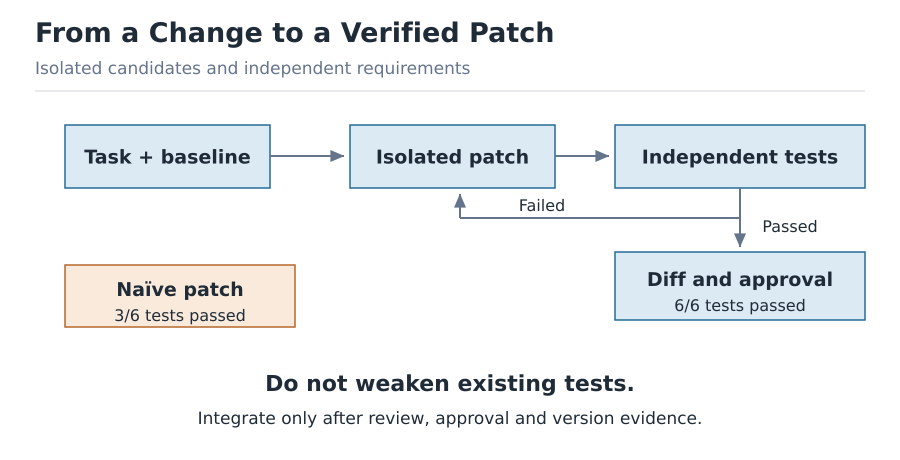

# M27-L9 – AI-Assisted Software Development and Verifiable Coding Agents {#L9}

**Course area:** M27 – AI Systems Engineering and MLOps

**Level:** Master · Optional specialisation

**Prerequisites:** M7, M14, M19.

**Learning objective:** Evaluate agent-driven software changes with restricted permissions, independent tests and reproducible evidence.

## From a code suggestion to a verified patch {#S1}

A coding agent can break down a task, inspect files, propose changes and execute test programs. These actions are not equivalent: an explanation is not a code change, a change is not a passing test, and a passing test does not demonstrate complete correctness. A verifiable process starts with clear requirements, a reproducible baseline and expected behaviour. The agent works in an isolated working tree with minimal permissions. Network access, secrets, publishing and irreversible integration steps must be controlled separately. Files, issues and test outputs may contain misleading instructions; they are data, not automatic authorisation.

## A patch for an edge case {#S2}




*Figure: From a change request to a verified patch.*

A function computes the failure rate from counts of failed and total requests. With no requests, it should return `None`, since a rate cannot be estimated. It should raise an error for negative counts or more failures than requests. A naïve patch, `bad / max(total, 1)`, avoids division by zero but incorrectly reports a zero rate when the dataset is empty. An independent test reveals the semantic error. The diagram shows a decision sequence that returns to the patch after a failed check. The code compares two manually written candidates and simulates an agentic verification loop without invoking a language model.

```python
def naive(bad,total):
    return bad/max(total,1)
def checked(bad,total):
    if not 0<=bad<=total:
        raise ValueError('invalid counts')
    return bad/total if total else None
cases=[(0,0,None),(0,5,0.0),(2,5,.4),(5,5,1.0),(-1,5,ValueError),(6,5,ValueError)]
def evaluate(fn):
    passed=[]
    for bad,total,expected in cases:
        try:
            observed=fn(bad,total)
        except ValueError:
            observed=ValueError
        passed.append(observed==expected)
    return passed
assert sum(evaluate(naive))==3
assert all(evaluate(checked))
print(evaluate(naive),evaluate(checked))
```

## Evaluation and limitations of agentic work {#S3}

Repository-based benchmarks such as SWE-bench assess whether systems can resolve specific software issues through code changes. In a real working environment, passing tests are only one concern: task scope, preserved existing functions, security and resource use also matter. Agents must not weaken tests merely to make a submission pass. Useful safeguards include independent regression tests, diff review, static analysis and negative test cases. Test output should identify the tested version and be reproducible so a reviewer can rerun the patch. Even a fully green test run supports only the properties tested, not an absence of every possible defect. Security-critical changes or actions with external effects require explicit approval.

## Exercise with solution {#S4}

An agent removes the test for empty input and then reports success. This is not a valid fix: the requirement is unmet and the measuring procedure has been altered. Restore the independent tests, examine the diff, and run both edge-case checks and existing regression tests on the version actually proposed for integration.

## Sources and further reading {#S5}

- [Jimenez et al. (2024): SWE-bench: Can Language Models Resolve Real-World GitHub Issues?](https://arxiv.org/abs/2310.06770) · abstract consulted
- [Google SRE Workbook: Canarying Releases](https://sre.google/workbook/canarying-releases/) · Chapter 16 consulted
