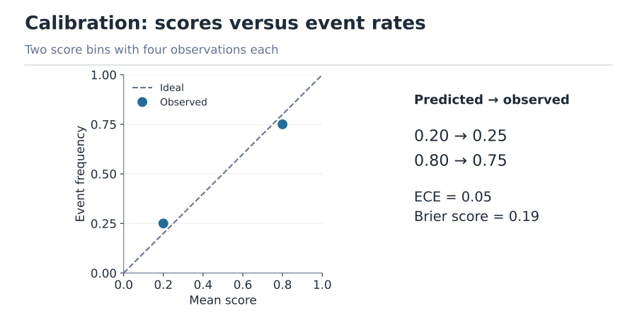

# M28-L1 – Calibration, Uncertainty and Selective Prediction {#L1}

**Course area:** M28 – Trustworthy AI, Data Protection and Security

**Level:** Master · Compulsory elective/cross-cutting

**Prerequisites:** M6, M10, M17, M27.

**Learning objective:** Distinguish calibration from discrimination and assess an abstention rule in terms of risk and coverage.

## Calibration and decision quality {#S1}

A model estimates the probability of a machine fault as 0.8. This number can be interpreted as a frequency-based probability only if, among comparable cases given that score, approximately 80% actually have a fault in the long run. Good ranking performance does not guarantee this property: a strictly monotonic transformation can retain the ranking while distorting every predicted probability. For a binary score $p(X)$, the ideal calibration condition is $E[Y\mid p(X)]=p(X)$ almost surely. With finite samples it is assessed approximately through score bins.

For a binary event, the Brier score $n^{-1}\sum_i(p_i-y_i)^2$ measures squared deviations from observed outcomes. It reflects aspects of predictive quality beyond calibration. A reliability diagram plots the mean predicted score against the observed event frequency in each bin; the diagonal represents ideal agreement. The Expected Calibration Error (ECE), in the binary variant used here, is $\sum_b(n_b/n)|\bar p_b-\bar y_b|$. It depends on bin choice, and apparent deviations for small groups are uncertain. Another commonly used measure, top-label ECE, compares confidence in the predicted class against whether that class prediction was correct, rather than evaluating the event score.

## Calibration and selective risk in the teaching example {#S2}




*Figure: Calibration: predicted scores and observed frequency.*

Eight synthetic requests receive scores $(.2,.2,.2,.2,.8,.8,.8,.8)$ and binary outcomes $(0,0,0,1,1,1,0,1)$. Both bins contain four cases. Their observed event frequencies are 0.25 and 0.75, so ECE is 0.05. The illustration plots both points. A second, separate classifier provides confidence scores and observed errors for six decisions. Rejecting predictions with confidence below 0.8 accepts three of six cases, all three correct. The empirical selective risk is 0 and coverage is 0.5. Zero observed errors do not establish that the true risk is zero.

For an acceptance set $A_\tau=\{i:c_i\ge\tau\}$, coverage is $C=|A_\tau|/n$ and selective risk is $R=\sum_{i\in A_\tau}e_i/|A_\tau|$. If the acceptance set is empty, $R$ is undefined. A lower proportion of errors may entail additional manual work, selective disadvantage or longer waiting times.

```python
import numpy as np
p=np.array([.2]*4+[.8]*4); y=np.array([0,0,0,1,1,1,0,1])
ece=sum(np.mean(p==v)*abs(v-y[p==v].mean()) for v in np.unique(p))
brier=np.mean((p-y)**2)
c=np.array([.95,.9,.8,.75,.6,.55]); e=np.array([0,0,0,1,0,1])
a=c>=.8
assert np.isclose(ece,.05) and np.isclose(brier,.19)
assert a.mean()==.5 and e[a].mean()==0
print(ece,brier,a.mean(),e[a].mean())
```

## Uncertainty and recalibration {#S3}

Temperature scaling uses $\operatorname{softmax}(z/T)$ for multiclass models with $T>0$. A validation data set determines the temperature, for example by minimising the negative log-likelihood. When $T>1$, differences between logits are flattened, while the predicted class remains unchanged if the ranking has a unique maximum. Isotonic regression is more flexible but needs more data. After changes to the model or data, recalibration, group performance and thresholds must be checked again using independent data. Out-of-distribution (OOD) detection, epistemic uncertainty (lack of knowledge) and aleatoric uncertainty (variation in observations) cannot all be represented fully by a single softmax score. Abstention requires an alternative decision process that is genuinely available and evaluated.

## Exercise with solution {#S4}

**Task:** What are selective risk and coverage when the threshold is 0.6 in the second example? What does the difference from 0.8 mean?

**Solution:** Five cases are accepted and one is wrong. Thus $C=5/6$ and $R=1/5=0.2$. Greater coverage comes with higher observed risk. Choosing a threshold would require an independent validation set, the cost of both errors and abstentions, and uncertainty intervals.

## Sources and further reading {#S5}

- [Guo et al. (2017): On Calibration of Modern Neural Networks](https://proceedings.mlr.press/v70/guo17a.html) · abstract and publication metadata consulted
- [Geifman und El-Yaniv (2019): SelectiveNet](https://proceedings.mlr.press/v97/geifman19a.html) · abstract consulted
