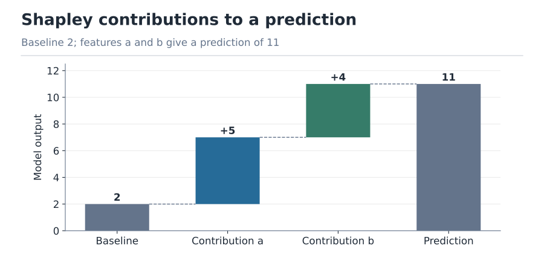

# M28-L2 – Explainability: Local and Global Methods {#L2}

**Course area:** M28 – Trustworthy AI, Data Protection and Security

**Level:** Master · Compulsory elective/cross-cutting

**Prerequisites:** M6, M10, M17, M27.

**Learning objective:** Distinguish local explanations from global model descriptions and calculate exact Shapley contributions for two features.

## Local and global explanations {#S1}

A prediction of high electricity consumption may arise from temperature, operating time and their interaction. An explanation describes how a model produces its output; it does not automatically say how an intervention in the real world would change consumption. Intrinsically interpretable models have structures that can be followed, such as small decision trees. Post-hoc methods approximate or decompose the behaviour of an already trained model. Local explanations focus on one input or its vicinity; global explanations summarise behaviour across multiple inputs or the distribution of interest.

LIME fits a simple surrogate model to model queries in a weighted neighbourhood of the point of interest. Its usefulness depends on neighbourhood selection and the fidelity of that local approximation. SHAP employs contributions drawn from cooperative game theory. For $m$ features and a value function $v(S)$, the Shapley value is the average marginal contribution of feature $j$ across possible orders:

$$\phi_j=\sum_{S\subseteq N\setminus\{j\}}\frac{|S|!(m-|S|-1)!}{m!}[v(S\cup\{j\})-v(S)].$$

How missing features are represented, such as through a reference distribution, is part of the definition of $v$.

## Shapley decomposition of our model {#S2}




*Figure: Shapley contributions to a prediction.*

Consider our own small regression model $f(a,b)=2+3a+b+2ab$, with baseline $(0,0)$ and point $(1,2)$. Features not included in a coalition are fixed to their baseline values. The four coalition values are $v(\varnothing)=2$, $v(\{a\})=5$, $v(\{b\})=4$ and $v(\{a,b\})=11$. The interaction amounts to 4. For $a$, the contribution is 3 without, and 7 with, $b$ already included; their average is 5. For $b$, the two contributions are 2 and 6, with average 4. Hence $11=2+5+4$. The waterfall diagram shows the baseline and contributions. This decomposition is exact for the chosen reference, not universal across other background distributions.

```python
from fractions import Fraction as F
def f(a,b): return 2+3*a+b+2*a*b
v0,va,vb,vab=f(0,0),f(1,0),f(0,2),f(1,2)
pa=F(va-v0+vab-vb,2); pb=F(vb-v0+vab-va,2)
assert (pa,pb)==(5,4) and v0+pa+pb==vab
print(v0,pa,pb,vab)
```

## Global evaluation and limitations {#S3}

Global permutation importance assesses how much a test loss changes when a feature's values are shuffled between observations. It must be evaluated on data not used for training. Correlated features can substitute for one another; unconditional permutations can also produce unrealistic combinations. Global SHAP summaries may use mean absolute contributions across a defined population. A large absolute value does not indicate an effect direction. Partial Dependence averages model predictions when a feature is fixed while varying other inputs; Individual Conditional Expectation (ICE) curves do this separately for individual observations. These methods too can evaluate implausible combinations. Useful explanations must be checked for fidelity to the model, stability under small changes and clear communication of their reference. Causal conclusions need further assumptions and evidence (M21).

## Exercise with solution {#S4}

**Task:** Calculate the contributions at $(a,b)=(1,1)$ using the same baseline. Which interaction is distributed?

**Solution:** The four values are 2, 5, 3 and 8. $\phi_a=(3+5)/2=4$, $\phi_b=(1+3)/2=2$. The interaction of 2 is shared equally between the features. The explanation does not recommend changing a feature in the real world.

## Sources and further reading {#S5}

- [Lundberg and Lee (2017): A Unified Approach to Interpreting Model Predictions](https://arxiv.org/abs/1705.07874) · abstract page consulted
- [Ribeiro, Singh and Guestrin (2016): Why Should I Trust You?](https://arxiv.org/abs/1602.04938) · abstract page consulted
