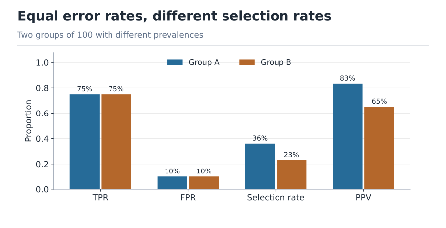

# M28-L3 – Fairness Metrics, Biases and Trade-offs {#L3}

**Course area:** M28 – Trustworthy AI, Data Protection and Security

**Level:** Master · Compulsory elective/cross-cutting

**Prerequisites:** M6, M10, M17, M27.

**Learning objective:** Calculate group-specific selection, true-positive and false-positive rates and recognise conflicts between fairness criteria.

## Group-based criteria {#S1}

A classifier recommends additional training opportunities. Historical target labels may reflect unequal access to previous training rather than actual need. Bias can arise during data collection, labelling, sampling, feature engineering or deployment. Even when a protected characteristic is not supplied as an input, correlated features may indirectly convey it. Fairness involves procedural justice, legitimate goals and opportunities to challenge a decision, not just metrics. The following groups A and B are entirely synthetic and contain no real personal data.

Demographic parity compares $P(\hat Y=1\mid G=g)$; equality of opportunity for positive cases compares the true-positive rate $P(\hat Y=1\mid Y=1,G=g)$. Equalised odds requires both this true-positive rate (TPR) and the false-positive rate (FPR), $P(\hat Y=1\mid Y=0,G=g)$, to be equal across groups. Positive predictive value (PPV) is the fraction of positive predictions that are actually positive. Each measure requires a defined denominator. When there are no positive cases, TPR is undefined.

## Two groups with equal TPR and FPR {#S2}




*Figure: Equal error rates but unequal selection.*

Group A contains 100 cases with 40 positive target values. Group B also has 100 cases but only 20 positive target values. Both classifiers achieve TPR = 0.75 and FPR = 0.10. In A, this gives 30 true and 6 false positives; in B, 15 true and 8 false positives. The selection rates are 0.36 and 0.23, while PPV values are $30/36\approx0.833$ and $15/23\approx0.652$. The diagram illustrates why equal conditional error rates do not necessarily imply equal selection rates or precision.

With prevalence $\pi_g=P(Y=1\mid G=g)$, Bayes' rule gives

$$\mathrm{PPV}_g=\frac{\mathrm{TPR}_g\pi_g}{\mathrm{TPR}_g\pi_g+\mathrm{FPR}_g(1-\pi_g)}.$$

With equal positive TPR and FPR but different prevalence, PPV generally differs. Exceptional cases, such as perfect classification, require separate consideration.

```python
from fractions import Fraction as F
def metrics(tp,fp,fn,tn):
    return F(tp,tp+fn),F(fp,fp+tn),F(tp+fp,tp+fp+fn+tn),F(tp,tp+fp)
a=metrics(30,6,10,54); b=metrics(15,8,5,72)
assert a[:2]==b[:2]==(F(3,4),F(1,10))
assert a[2:]==(F(36,100),F(5,6)) and b[2:]==(F(23,100),F(15,23))
print(a,b)
```

## Audits and trade-offs {#S3}

Before an audit, explain why the target, group definitions and comparison measure are suitable. Report error rates alongside sample counts, statistical uncertainty and, where appropriate, intersectional groups. Small groups require particular care; merely combining them may hide disadvantage. Possible measures include better data collection and label review, constraints in training, and adjustments to downstream decisions. Group-specific thresholds may raise legal or ethical problems and require separate review. Decisions about trade-offs should not be left solely to an optimisation algorithm. A fairness metric proves neither the absence of discrimination nor legal compliance in general.

## Exercise with solution {#S4}

**Task:** Suppose group B now has 40 positive and 60 negative cases, while the conditional rates remain unchanged. What are its selection rate and PPV?

**Solution:** There are 30 true and 6 false positives, giving a 36% selection rate and a PPV of $5/6$. In the original teaching example, the difference at fixed conditional rates resulted from different prevalence. The arithmetic cannot tell us whether that prevalence difference is real, caused by measurement error or due to systemic disadvantage.

## Sources and further reading {#S5}

- [Hardt, Price and Srebro (2016): Equality of Opportunity in Supervised Learning](https://arxiv.org/abs/1610.02413) · article page consulted
- [Chouldechova (2017): Fair Prediction with Disparate Impact](https://arxiv.org/abs/1610.07524) · abstract page consulted
