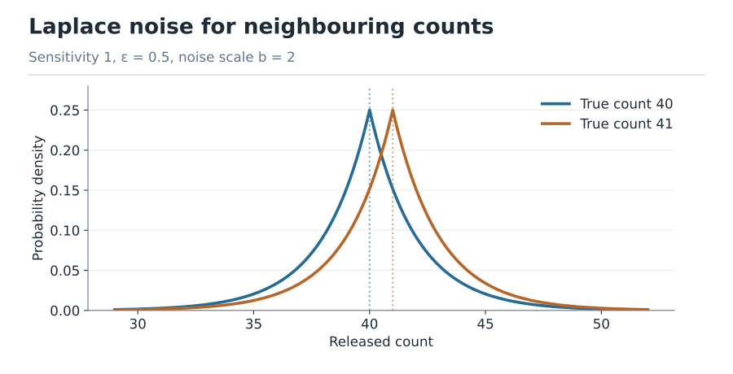

# M28-L4 – Data Protection Techniques and Differential Privacy {#L4}

**Course area:** M28 – Trustworthy AI, Data Protection and Security

**Level:** Master · Compulsory elective/cross-cutting

**Prerequisites:** M6, M10, M17, M27.

**Learning objective:** Formulate a formal privacy guarantee and choose the Laplace scale for a count query.

## Privacy as a formal property {#S1}

Removing names does not necessarily anonymise a data set. Timestamps, rare features and combinations with other sources may allow re-identification. Pseudonymisation separates identities from working data, but is generally reversible when the linking information exists. Access controls, encryption, data minimisation and deletion policies address different risks. Differential Privacy (DP) adds a mathematical guarantee for the output of a randomised mechanism.

Let $D,D'$ be neighbouring data sets which, in this example, differ by the addition or removal of one person contributing one record. For all measurable sets of outputs $S$, $(\varepsilon,\delta)$-DP requires:

$$P(M(D)\in S)\le e^\varepsilon P(M(D')\in S)+\delta.$$

Pure DP uses $\delta=0$. A smaller $\varepsilon$ limits one person's influence more strictly. It is not a percentage of privacy. The definition of neighbouring data sets must match the entity being protected; when one person contributes multiple records, their total contribution must be bounded at person level. DP does not promise that no inference about a person is possible; it limits the additional influence of their participation.

## Laplace mechanism for a count query {#S2}




*Figure: Laplace noise around adjacent counts.*

A count query $q$ counts at most one contribution per person. Its global $L_1$ sensitivity is $\Delta q=1$. The Laplace mechanism releases $q(D)+Z$, where $Z\sim\mathrm{Lap}(0,b)$ and $b=\Delta q/\varepsilon$. With $\varepsilon=0.5$, $b=2$. The density is $g(z)=\exp(-|z|/b)/(2b)$ and the standard deviation is $\sqrt{2}b\approx2.83$. The triangle inequality bounds the density ratio of two neighbouring output distributions by $\exp(\Delta q/b)=e^\varepsilon$. The plot shows densities for true counts 40 and 41; their extensive overlap illustrates, but does not prove, the guarantee.

The probability that absolute noise is no greater than $t$ is $1-e^{-t/b}$ for $t\ge0$. With $t=4$, this is approximately 86.47%. The released value can be non-integer or negative. Subsequent rounding or clipping to an allowed range without further access to raw data retains the DP guarantee, but may introduce bias.

```python
import math
b=1/.5
p=1-math.exp(-4/b)
def density(x,q): return math.exp(-abs(x-q)/b)/(2*b)
ratios=[density(x/10,40)/density(x/10,41) for x in range(300,501)]
assert max(ratios)<=math.exp(.5)+1e-12 and math.isclose(p,.8646647167633873)
print(b, math.sqrt(2)*b,p,max(ratios))
```

## Composition and practical limitations {#S3}

When the same protected population is queried repeatedly, privacy budgets must be accounted for. The simple sequential composition bound adds the respective epsilon and delta values. More advanced accounting techniques can provide tighter bounds under suitable assumptions. Post-processing that does not access the raw data again uses no further budget. DP-SGD clips individual gradient contributions and adds noise; its actual guarantee depends, among other factors, on sampling, clipping, noise scale and number of training steps. Production mechanisms require vetted libraries, secure randomness, carefully enforced contribution bounds and protection against side channels. The code above checks distribution values; it is not a DP release service. DP alone ensures neither legal compliance nor comprehensive data security.

## Exercise with solution {#S4}

**Task:** Three queries each use pure DP with $\varepsilon=0.3$ on the same population. What does simple composition imply? What scale is needed for one count query with at most two contributions per person and $\varepsilon=0.3$?

**Solution:** The total guarantee is at most $\varepsilon=0.9$, $\delta=0$. Under add/remove-one-person adjacency, sensitivity is at most 2 and $b=2/0.3\approx6.67$. A bound per row does not replace the required bound per person.

## Sources and further reading {#S5}

- [Dwork and Roth (2014): The Algorithmic Foundations of Differential Privacy](https://www.cis.upenn.edu/~aaroth/privacybook.html) · book overview consulted
- [EU: Regulation (EU) 2016/679 (GDPR)](https://eur-lex.europa.eu/eli/reg/2016/679/oj) · direct retrieval blocked by JavaScript check
