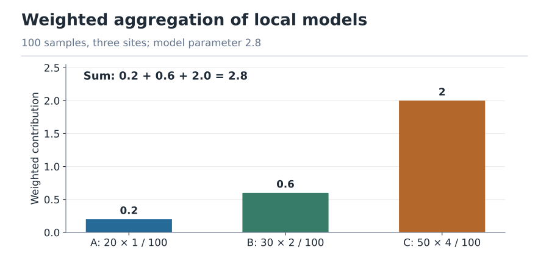

# M28-L5 – Federated Learning and Confidential Data Processing {#L5}

**Course area:** M28 – Trustworthy AI, Data Protection and Security

**Level:** Master · Compulsory elective/cross-cutting

**Prerequisites:** M6, M10, M17, M27.

**Learning objective:** Calculate federated model aggregation and explain the limits of data locality and secure aggregation.

## Distributed training {#S1}

Three workshops wish to improve a prediction model jointly without transferring their complete measurement logs to a central location. In horizontal federated learning, participants have similar feature schemas but different observations. A coordinator distributes shared model parameters, selected participants train locally, send updates back and the coordinator aggregates them. Vertical federated learning instead involves different feature sets for overlapping entities, requiring additional matching and protection mechanisms.

The objective for weighted empirical risk minimisation is $F(w)=\sum_k(n_k/N)F_k(w)$ with $N=\sum_k n_k$. Each local loss $F_k$ is averaged over its own data set. After local training steps, FedAvg aggregates the local models $w_k$ as $w^{t+1}=\sum_k(n_k/N)w_k$. Following a single common gradient descent step, this weighting matches the central gradient on the participating data; after several local steps the results need not be identical. Non-identically distributed data (non-IID), participant drop-outs and varying computational capacity affect convergence and representation.

## FedAvg and masked summation {#S2}




*Figure: Weighted averaging of local model updates.*

In the teaching example, sites with 20, 30 and 50 observations return scalar local model parameters 1, 2 and 4. The unweighted average would be $7/3\approx2.333$; FedAvg instead gives $(20+60+200)/100=2.8$. The plot shows each site's contribution to the weighted sum. Weighting by sample size corresponds to the stated objective but places more emphasis on larger sites; if every site is to carry equal importance, a different objective is possible.

With secure aggregation, the coordinator should learn only the aggregate, not individual updates. A simplified arithmetic illustration uses pairwise cancelling masks: when participants add masks to their contributions and all masks cancel in the sum, the aggregate is recovered. Real protocols also require a precise cryptographic security definition, key management and resilience to drop-outs. The code below simulates only algebraic cancellation, not a secure protocol.

```python
from fractions import Fraction as F
n=[20,30,50]; w=[1,2,4]; s=[a*b for a,b in zip(n,w)]
m01,m02,m12=17,31,9
masked=[s[0]+m01+m02,s[1]-m01+m12,s[2]-m02-m12]
assert sum(masked)==sum(s)==280
assert F(sum(s),sum(n))==F(14,5)
print(s,masked,F(sum(masked),sum(n)))
```

## Confidential processing and limitations {#S3}

Even if raw data remain local, updates can leak information; malicious participants can also corrupt a model by submitting unsuitable updates. Secure aggregation protects individual contributions under the assumptions of its protocol, but cannot prevent every inference from a published aggregate. DP can additionally limit the influence of individual participants or records. Encryption during storage and transfer protects other processing stages. Trusted execution environments (TEEs) aim to isolate data while they are processed, subject to hardware and side-channel assumptions. Secure multiparty computation and homomorphic encryption permit certain computations without exposing plaintext, often with additional processing and communication costs. Architectural choices must follow the threat model, data distributions, protection goals and expected failure conditions.

## Exercise with solution {#S4}

**Task:** Site C drops out before any exchange. A and B are aggregated alone using newly agreed masks and weights. What parameter results, and why is simply deleting the third masked value from the original sum insufficient?

**Solution:** $(20+60)/(20+30)=1.6$. With the original masking scheme, masks for pairs involving C would no longer cancel. A real protocol must handle drop-outs under its security assumptions; simply dropping one masked contribution produces the wrong aggregate.

## Sources and further reading {#S5}

- [McMahan et al. (2017): Communication-Efficient Learning of Deep Networks from Decentralized Data](https://proceedings.mlr.press/v54/mcmahan17a.html) · abstract page consulted
- [Bonawitz et al. (2017): Practical Secure Aggregation for Privacy-Preserving Machine Learning](https://research.google/pubs/practical-secure-aggregation-for-privacy-preserving-machine-learning/) · abstract consulted
- [Dwork and Roth (2014): The Algorithmic Foundations of Differential Privacy](https://www.cis.upenn.edu/~aaroth/privacybook.html) · book overview consulted
