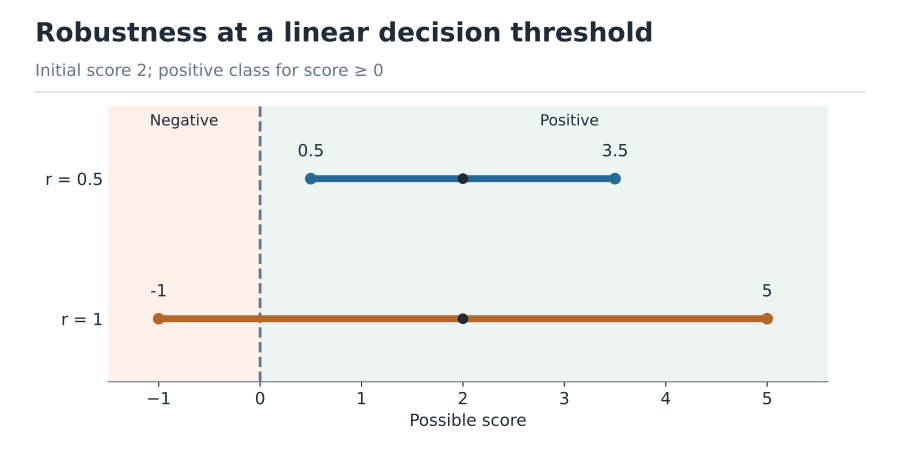

# M28-L6 – Threat Models, Robustness and Red Teaming {#L6}

**Course area:** M28 – Trustworthy AI, Data Protection and Security

**Level:** Master · Compulsory elective/cross-cutting

**Prerequisites:** M6, M10, M17, M27.

**Learning objective:** Classify threats across the model lifecycle and calculate robustness within a bounded synthetic test model.

## Threat models and robustness {#S1}

A model tested before delivery may later become unreliable because of unusual data, errors or deliberate manipulation. A threat model identifies assets to protect (such as decision integrity, confidentiality or service availability), exposed interfaces, the assumed capabilities and knowledge of an attacker, and the permitted scope of testing. Test conclusions are meaningful only under these assumptions. During training, tampered data or model updates can undermine integrity. During inference, deliberately altered yet plausible inputs may trigger errors. Information leakage and model extraction concern confidentiality and intellectual property. With generative systems, manipulated external content and unintended tool actions present additional system risks.

A robustness measurement requires a well-defined set of permitted input variations. Local robustness for a classifier can mean that the predicted class is unchanged for every $\tilde x$ in a specified neighbourhood of $x$. Empirical tests provide evidence against tested perturbations. Formal certification covers only the precisely defined perturbation set and must account for implementation limitations.

## Robustness interval for a linear decision {#S2}




*Figure: Score robustness near a linear decision boundary.*

A synthetic quality-inspection system uses a linear score $s(x)=2x_1-x_2-1$. The positive class is selected when $s\ge0$. For $x=(2,1)$, the score is 2. Sensor errors are modelled by $\|\Delta x\|_\infty\le r$. Since $|w^T\Delta x|\le\|w\|_1 r=3r$, the possible score lies in $[2-3r,2+3r]$. For $r=0.5$, the lower bound is 0.5 and the decision stays positive. With $r=1$, the interval extends from -1 to 5 and contains both classes. The strict positive-score guarantee applies when $r<2/3$; at exactly $2/3$, the class is still positive under the stated tie rule. The diagram shows the score intervals and threshold. In real data, admissible disturbances are often more complicated than a norm ball.

```python
from itertools import product
from fractions import Fraction as F
for r,expected in [(F(1,2),(F(1,2),F(7,2))), (F(1),(F(-1),F(5)))]:
    scores=[2*(2+a)-(1+b)-1 for a,b in product([-r,r],repeat=2)]
    assert (min(scores),max(scores))==expected
    print(r,min(scores),max(scores))
```

## Authorised security testing and safeguards {#S3}

An authorised red team develops tests from realistic risk scenarios, works in an isolated environment with dummy data and agreed boundaries, and records findings by reproducibility, impact and severity. Risks should be reduced by design where feasible: protect the provenance and integrity of training data, minimise permissions, separate untrusted content from instructions, validate outputs, limit tool permissions and test fallbacks and rollback paths. Adversarial training may improve robustness to specified perturbations but cannot guarantee unlimited security. A red-team exercise is not permission to test third-party systems. After fixes, individual findings are reproduced and regression tests added; monitoring observes residual risks in operation.

## Exercise with solution {#S4}

**Task:** For the same model, the initial score is only 0.3. What is the maximum perturbation radius that guarantees a non-negative score under the same assumptions?

**Solution:** From $0.3-3r\ge0$ we obtain $r\le0.1$. A change in input scaling or in the threat model requires a new calculation. A robustness guarantee does not necessarily imply correct classification: a consistently wrong decision is still wrong.

## Sources and further reading {#S5}

- [Vassilev et al. (2025): Adversarial Machine Learning: A Taxonomy and Terminology of Attacks and Mitigations](https://www.nist.gov/publications/adversarial-machine-learning-taxonomy-and-terminology-attacks-and-mitigations-0) · NIST publication page consulted
- [NIST (2023): Artificial Intelligence Risk Management Framework 1.0](https://nvlpubs.nist.gov/nistpubs/ai/NIST.AI.100-1.pdf) · PDF table of contents and p. 20 (PDF p. 25) inspected
