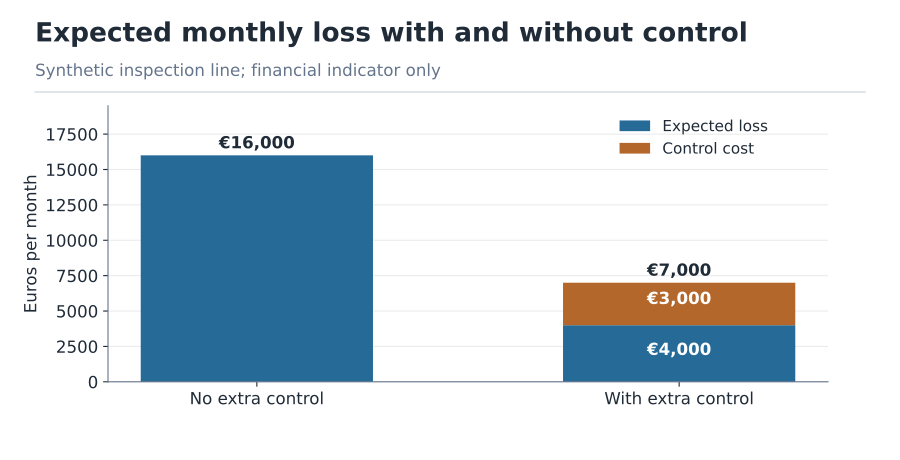

# M28-L7 – Risk Management, Governance and Legal Responsibility {#L7}

**Course area:** M28 – Trustworthy AI, Data Protection and Security

**Level:** Master · Compulsory elective/cross-cutting

**Prerequisites:** M6, M10, M17, M27.

**Learning objective:** Create an auditable risk register, prioritise controls and distinguish organisational from legal obligations.

## Governance and risk registers {#S1}

An image recognition system assists the visual inspection of manufactured components. False approvals and unnecessary rejection produce different harms; potential data protection violations, downtime and consequences of incorrect work instructions must also be considered. Risks arise from the interaction of the model, interfaces, users, data and deployment environment. Governance allocates accountability, decision-making powers, controls, documentation and escalation routes. A risk register should identify at least the hazard, triggering conditions, affected parties, impact, existing controls, accountable role, supporting evidence, residual risk and next review date. Approval for deployment must be tied to defined acceptance conditions.

The voluntary NIST AI RMF 1.0 organises such activities into Govern, Map, Measure and Manage. Govern addresses organisational foundations, Map the deployment context, Measure risk assessment, and Manage the treatment of identified risks. These functions are not a rigid sequence and do not replace legal review. A technical benchmark alone cannot capture the consequences of deploying a system.

## Expected costs and residual risks {#S2}




*Figure: Expected monthly risk with and without control.*

For a synthetic inspection line, suppose 1,000 components are checked each month. Before an additional control, 2% are incorrectly approved despite being defective; after that control, 0.5% do. For this example, assume a fixed loss of €800 for every such approval. Expected monthly loss before the control is $1000\cdot0.02\cdot800=16000$ euros, and after it $1000\cdot0.005\cdot800=4000$ euros. The extra control costs €3,000 a month, so the expected financial saving is €9,000. The graph shows expected losses and control costs. This calculation assumes constant volume, error rates and consequences; it does not estimate real-world damage.

More generally, for a suitable decomposition into discrete loss events, $L=\sum_i p_i c_i$ is the expected value of a random loss. Rights that cannot be monetised, extremely rare severe outcomes, accumulating harms and uncertainty require additional qualitative and scenario-based assessment. An expected financial saving is not sufficient on its own to approve deployment.

```python
from decimal import Decimal as D
n=D(1000); cost=D(800); control=D(3000)
old=n*D('.02')*cost; new=n*D('.005')*cost
saving=old-new-control
assert (old,new,saving)==(D(16000),D(4000),D(9000))
print(old,new,control,saving)
```

## Legal framework and scope of review {#S3}

The EU AI Act (Regulation (EU) 2024/1689) assigns requirements to certain systems and organisational roles. Article 9, as consulted through the European Commission's AI Act Service Desk, requires a documented risk-management system for high-risk AI systems, maintained and periodically reviewed across the lifecycle. This includes foreseeable hazards and misuse, suitable safeguards and testing. Article 14 addresses human oversight; additional obligations depend on the system's actual classification. A data protection assessment is distinct. Whether personal data are processed, which legal basis applies and what obligations arise must be assessed for the particular use under the GDPR and other applicable laws. The EUR-Lex texts were inaccessible in direct retrieval; the AI Act articles described here came from the Commission's explorer (consolidated version indicated there as 27 July 2026). No statement is made about current dates of application, and no definitive legal review has been performed. Before real-world deployment, the official texts, transitional provisions and classification must be checked separately.

## Exercise with solution {#S4}

**Task:** Suppose the control now costs €13,000 a month. How does the expected financial result change? May the control be omitted for that reason alone?

**Solution:** $16000-4000-13000=-1000$ euros. Under the assumptions made, the financial teaching indicator argues against the control. It does not imply that the control is unnecessary: safety requirements, affected people's rights, uncertainty, alternatives and regulatory duties must be assessed independently.

## Sources and further reading {#S5}

- [NIST (2023): Artificial Intelligence Risk Management Framework 1.0](https://nvlpubs.nist.gov/nistpubs/ai/NIST.AI.100-1.pdf) · PDF table of contents and p. 20 (PDF p. 25) inspected
- [EU AI Act Service Desk: Article 9 – Risk management system](https://ai-act-service-desk.ec.europa.eu/en/ai-act/article-9) · article text consulted, explorer states consolidated version dated 2026-07-27
- [EU AI Act Service Desk: Article 14 – Human oversight](https://ai-act-service-desk.ec.europa.eu/en/ai-act/article-14) · article text consulted, explorer states consolidated version dated 2026-07-27
- [EU: Regulation (EU) 2016/679 (GDPR)](https://eur-lex.europa.eu/eli/reg/2016/679/oj) · direct retrieval blocked by JavaScript check
- [EU: Regulation (EU) 2024/1689 (AI Act)](https://eur-lex.europa.eu/eli/reg/2024/1689) · direct retrieval blocked by JavaScript check
