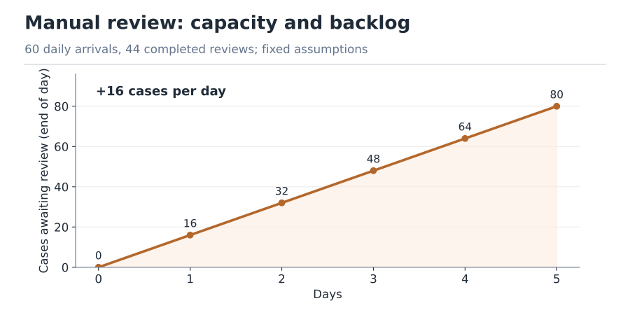

# M28-L8 – Human Oversight, Interaction and Impact Assessment {#L8}

**Course area:** M28 – Trustworthy AI, Data Protection and Security

**Level:** Master · Compulsory elective/cross-cutting

**Prerequisites:** M6, M10, M17, M27.

**Learning objective:** Design human oversight as a testable process and assess outcomes using error rates, intervention capacity and complaint routes.

## Effective human oversight {#S1}

An assistance system ranks maintenance requests by urgency. Employees may follow or change its recommendations. Effective oversight depends on available time, expertise, access to inputs, incentives and actual authority. A confirmation button by itself does not establish independent judgement. Automation bias is the tendency to follow an automated recommendation despite contrary evidence. Conversely, too many warnings can cause important alerts to be missed. Interfaces should appropriately show uncertainty, limits of applicability, the relevant inputs and feasible alternatives, avoiding unwarranted precision.

Human-in-the-loop means that a person intervenes within the decision pathway; human-on-the-loop means a supervisory role with the ability to intervene. The appropriate arrangement depends on potential harm, available response time and the real ability to act. Escalation, stopping and returning to a safe process must be planned, tested and adequately staffed.

## Capacity of a manual review process {#S2}




*Figure: Manual review backlog and capacity.*

A synthetic service handles 200 cases each day, of which 30% are referred for manual review under a predefined rule: 60 cases. Two reviewers each have 180 minutes of net review time, and each case takes exactly eight minutes in the simplified model. With sequential processing, each person can complete at most 22 cases per day, or 44 together. At a constant arrival rate, the backlog therefore grows by 16 cases each day. The chart illustrates why an abstention rule without sufficient review capacity may fail as a safety measure. The theoretical minimum number of reviewers is $\lceil60/22\rceil=3$. Fluctuations, breaks, complex cases and time-critical decisions may require further capacity.

A second test should compare decision quality with and without assistance using separately allocated test cases, for example errors, processing times, override rates and missed model errors. The number of changed recommendations is neither proof of quality nor an unambiguous indicator of errors.

```python
from math import ceil
incoming=200*30//100; per_reviewer=180//8; capacity=2*per_reviewer
backlog=[d*(incoming-capacity) for d in range(6)]
assert (incoming,capacity,backlog[-1],ceil(incoming/per_reviewer))==(60,44,80,3)
print(incoming,capacity,backlog,ceil(incoming/per_reviewer))
```

## Impact assessment and feedback {#S3}

An impact assessment describes purpose, limitations, affected people, potential harms, their distribution, mitigations, responsibilities and monitoring indicators. Participation by those affected can reveal problems that laboratory tests miss. Accessible complaint and correction processes must remain available even when the system fails. Changes in the deployment context or model require reassessment. According to Article 14 of the EU AI Act as read through the Commission's Service Desk, appropriate human oversight capabilities should be available for high-risk systems. Article 27 concerns a fundamental-rights impact assessment for certain deployers and contexts, not for every AI application. Legal applicability and the relationship to data protection impact assessments must be checked against the official texts; direct retrieval from EUR-Lex was blocked. No legal classification is made for this teaching example.

## Exercise with solution {#S4}

**Task:** One more reviewer with 180 minutes of net review time joins the team. Can the backlog of 80 cases be eliminated if the new arrival rate stays unchanged?

**Solution:** Capacity increases to $3\cdot22=66$ cases per day. Six outstanding cases can thus be cleared each day, giving $\lceil80/6\rceil=14$ days. The model assumes fixed review times and continuous availability. Real planning must consider urgency, overload, errors under time pressure and response deadlines.

## Sources and further reading {#S5}

- [NIST (2023): Artificial Intelligence Risk Management Framework 1.0](https://nvlpubs.nist.gov/nistpubs/ai/NIST.AI.100-1.pdf) · PDF table of contents and p. 20 (PDF p. 25) inspected
- [EU AI Act Service Desk: Article 14 – Human oversight](https://ai-act-service-desk.ec.europa.eu/en/ai-act/article-14) · article text consulted, explorer states consolidated version dated 2026-07-27
- [EU AI Act Service Desk: Article 27 – Fundamental rights impact assessment](https://ai-act-service-desk.ec.europa.eu/en/ai-act/article-27) · article text consulted, explorer states consolidated version dated 2026-07-27
- [EU: Regulation (EU) 2016/679 (GDPR)](https://eur-lex.europa.eu/eli/reg/2016/679/oj) · direct retrieval blocked by JavaScript check
- [EU: Regulation (EU) 2024/1689 (AI Act)](https://eur-lex.europa.eu/eli/reg/2024/1689) · direct retrieval blocked by JavaScript check
