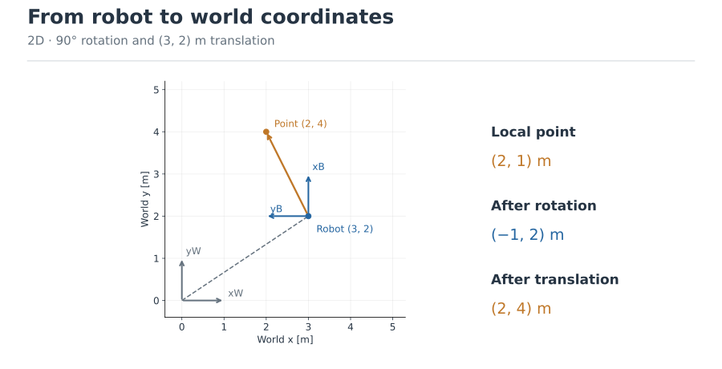

# M29-L1 – Sensors, Perception and Coordinate Frames {#L1}

**Course area:** M29 – Robotics and Autonomous Systems

**Level:** Master · Compulsory elective/applications

**Prerequisites:** M18, M22, M25.

**Learning objective:** Relate sensor measurements in time and space, calculate rigid transformations and account for measurement uncertainty.

## A measurement is not a state {#S1}

An autonomous transport trolley needs to recognise a loading station and determine its position relative to a map. Wheel encoders measure wheel rotation; an inertial measurement unit (IMU) measures angular velocity and specific force; a camera records brightness values; and LiDAR estimates distances using emitted light signals. No single sensor provides the complete state without a model. Encoders can be wrong when wheels slip, cameras are sensitive to lighting, and reflective surfaces can distort range measurements. A measurement model $z=h(x)+v$ links the unknown state $x$ to the observation $z$ and measurement noise $v$. Calibration determines, among other things, the parameters of this mapping and the sensor's mounting pose on the vehicle. Timestamps must refer to a common time base: at $1.2\,\mathrm{m/s}$, a delay of $0.1\,\mathrm{s}$ already corresponds to $0.12\,\mathrm{m}$ of travel.

## Reference frames and transformations {#S2}




*Figure: Transforming points from robot to world coordinates.*

We choose a right-handed plane with world coordinates W and robot coordinates B. The pose comprises a translation $t=(3,2)^\top\,\mathrm{m}$ and an orientation $\theta=90^\circ=\pi/2$. The local vector $p_B=(2,1)^\top\,\mathrm{m}$ denotes a detected point relative to the robot. The rotation maps B-coordinates to W-coordinates:

$$R(\theta)=\begin{pmatrix}\cos\theta&-\sin\theta\\\sin\theta&\cos\theta\end{pmatrix},\qquad p_W=R p_B+t.$$

This gives $R p_B=(-1,2)^\top$ and therefore $p_W=(2,4)^\top\,\mathrm{m}$. The inverse mapping is $p_B=R^\top(p_W-t)$ because $R^\top R=I$. In homogeneous coordinates, $T_{WB}=\begin{pmatrix}R&t\\0&1\end{pmatrix}$ combines rotation and translation; in 2D the bottom row contains two zeros and a one. If sensor S has a fixed mounting pose relative to the vehicle, $T_{WS}=T_{WB}T_{BS}$; the rightmost transformation acts first. In 3D, $R\in SO(3)$ and $T\in SE(3)$, and rotations generally do not commute. Conventions such as REP-103 simplify integration but do not replace checking a sensor's actual axis definitions.

```python
import numpy as np
R=np.array([[0.,-1.],[1.,0.]])
t=np.array([3.,2.]); p=np.array([2.,1.]); w=R@p+t
assert np.allclose(w,[2,4]) and np.allclose(R.T@(w-t),p)
C=R@np.diag([.04,.01])@R.T
assert np.allclose(C,np.diag([.01,.04]))
print(w,C.diagonal())
```

## Uncertainty and data quality {#S3}

For a known pose, measurement covariance transforms according to $\Sigma_W=R\Sigma_B R^\top$. A local variance of $0.04\,\mathrm{m^2}$ along x and $0.01\,\mathrm{m^2}$ along y swap their axis assignments under the rotation above. If the pose itself is uncertain, its covariance and any cross-covariances must also be taken into account, for example through the Jacobian of the complete transformation. A short range reading does not automatically imply an obstacle: plausibility checks, sensor status and measurement time are all part of data processing. When measurements conflict, a robotic system must not simply select whichever reading supports its preferred route.

## Exercise with solution {#S4}

**Task:** A sensor is mounted $0.5\,\mathrm{m}$ in front of the robot without any additional rotation. It reports a point at $(1,0)^\top\,\mathrm{m}$ in its sensor frame. Where is the point in world coordinates for the pose above?

**Solution:** In the robot frame it lies at $(1.5,0)^\top$. Rotation and translation yield $(3,3.5)^\top\,\mathrm{m}$. The mounting offset must be applied before the transformation to world coordinates.

## Sources and further reading {#S5}

- [Lynch and Park (2017): Modern Robotics](https://modernrobotics.northwestern.edu/nu-gm-book-resource/) · chapter overview and descriptions for Chapters 2, 3, 10 and 11 opened
- [Foote and Purvis: REP-103 – Standard Units of Measure and Coordinate Conventions](https://reps.openrobotics.org/rep-0103/) · conventions and SI units opened
- [Thrun, Burgard and Fox (2005): Probabilistic Robotics](https://mitpress.mit.edu/9780262201629/probabilistic-robotics/) · publisher page opened
