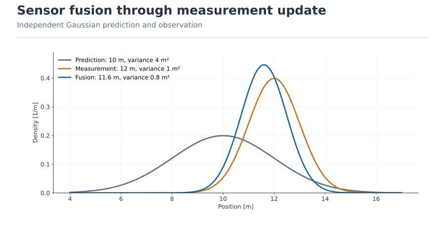

# M29-L2 – State Estimation and Sensor Fusion {#L2}

**Course area:** M29 – Robotics and Autonomous Systems

**Level:** Master · Compulsory elective/applications

**Prerequisites:** M18, M22, M25.

**Learning objective:** Formulate a Bayesian filter model, calculate a Kalman measurement update and explain limitations of combining sensors.

## Observing a moving system {#S1}

A trolley moves along a corridor. Its position is not directly known but estimated from a motion model and measurements. A state vector may contain position, orientation, velocity and sensor drift. The discrete linear model is $x_k=F x_{k-1}+B u_k+w_k$ and $z_k=H x_k+v_k$, where $u_k$ is the control input, $w_k$ the process noise and $v_k$ the measurement noise. The covariances $Q$ and $R$ describe, among other things, the reliability of the motion model and sensor. Under linear Gaussian assumptions, a Kalman filter tracks the mean and covariance of the state distribution. This is not generally sufficient for nonlinear or multimodal distributions.

## Prediction and measurement update {#S2}




*Figure: Fusion of prediction and sensor measurements.*

The prediction is $\hat x^-=F\hat x+B u$ with $P^-=FPF^\top+Q$. The innovation $r=z-H\hat x^-$ is the difference between the measurement and its predicted value. It follows that

$$S=HP^-H^\top+R,\qquad K=P^-H^\top S^{-1},\qquad \hat x^+=\hat x^-+Kr.$$

For the covariance, the numerically robust Joseph form is useful: $P^+=(I-KH)P^-(I-KH)^\top+KRK^\top$. Consider a scalar teaching example: the trolley is predicted to be at $10\,\mathrm{m}$ with variance $4\,\mathrm{m^2}$. An independent distance measurement, converted into a world position, yields $12\,\mathrm{m}$ with variance $1\,\mathrm{m^2}$. Then $K=4/5=0.8$; the corrected estimate is $11.6\,\mathrm{m}$ and its variance is $0.8\,\mathrm{m^2}$. The graphic compares the two input densities with the narrower fused density. In this model the more precise measurement receives greater weight without completely discarding the prediction.

```python
import numpy as np
x,P,z,R=10.,4.,12.,1.
K=P/(P+R); post=x+K*(z-x); var=(1-K)**2*P+K*K*R
assert np.allclose([K,post,var],[.8,11.6,.8])
nis=(z-x)**2/(P+R)
assert np.isclose(nis,.8)
print(post,var,nis)
```

## Nonlinearity and faulty measurements {#S3}

The Extended Kalman Filter (EKF) linearises motion and measurement models around the current estimate. An Unscented Kalman Filter uses selected sigma points to approximate transformed moments; particle filters represent a distribution through weighted samples and can model multiple possible locations. The choice depends on the dynamics, dimensionality, computing budget and observability. Shared error sources—for example, two algorithms using the same camera images—make measurements correlated. Treating them as independent can lead to underestimating uncertainty. For diagnosing errors, the normalised innovation squared $r^\top S^{-1} r$ can be examined. Under suitable model assumptions it follows a chi-squared distribution with degrees of freedom equal to the measurement dimension. An unusual value can indicate an outlier, incorrect association or an unsuitable model; it is not, on its own, evidence of safety.

## Exercise with solution {#S4}

**Task:** Fuse the same prediction with an independent measurement of $12\,\mathrm{m}$ having variance $4\,\mathrm{m^2}$.

**Solution:** $K=4/(4+4)=0.5$, giving $\hat x^+=11\,\mathrm{m}$ and $P^+=2\,\mathrm{m^2}$. Equally precise inputs receive equal weight. Reusing the same measurement twice, however, does not provide independent additional information.

## Sources and further reading {#S5}

- [Thrun, Burgard and Fox (2005): Probabilistic Robotics](https://mitpress.mit.edu/9780262201629/probabilistic-robotics/) · publisher page opened
- [Cadena et al. (2016): Past, Present, and Future of Simultaneous Localization And Mapping](https://arxiv.org/abs/1606.05830) · introduction and Section II read selectively
- [Tedrake: Underactuated Robotics](https://underactuated.mit.edu/) · contents overview of Policy Search and Feedback opened
