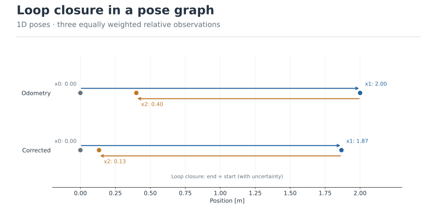

# M29-L3 – Localisation, Mapping and SLAM {#L3}

**Course area:** M29 – Robotics and Autonomous Systems

**Level:** Master · Compulsory elective/applications

**Prerequisites:** M18, M22, M25.

**Learning objective:** Distinguish localisation from mapping and calculate the effect of loop closure in a pose graph.

## Map, pose and observation {#S1}

When a map is already known, localisation estimates the current pose relative to it. When the complete trajectory is known, a mapping method can build a map of the surroundings from measurements. SLAM (Simultaneous Localisation and Mapping) combines both tasks: positions, orientations and map features are estimated jointly. Two-dimensional occupancy grids can, for example, represent the probability of occupancy by an obstacle for each cell; landmark maps contain selected identifiable features. A semantic map adds meanings such as door or passageway. An unknown cell must not be treated as traversable free space.

## Pose graph and loop closure {#S2}




*Figure: Loop closure in a pose graph.*

Odometry accumulates motion increments, so even small errors accumulate. Recognising a previously visited place can provide an additional relative pose measurement. In a pose graph, variables represent poses and edges represent relative observations. The following deliberately one-dimensional example fixes $x_0=0$: without this constraint, the entire coordinate frame could be translated arbitrarily. Two odometry steps measure $+2.0$ and $-1.6\,\mathrm{m}$. Odometry alone puts the second pose at $0.4\,\mathrm{m}$. An independent place-recognition measurement reports that the endpoint coincides with the starting point (relative measurement 0). With equal measurement variances, minimising the weighted sum of squared residuals reduces here to

$$\min_{x_1,x_2}(x_1-2)^2+(x_2-x_1+1.6)^2+x_2^2.$$

All residuals have units of metres; a common weight in $\mathrm{m^{-2}}$ has been omitted. Differentiating and setting the derivatives to zero gives $2x_1-x_2=3.6$ and $-x_1+2x_2=-1.6$. Consequently $x_1=1.8667\,\mathrm{m}$ and $x_2=0.1333\,\mathrm{m}$. Loop closure corrects both poses, but finite measurement uncertainty means it does not enforce an exact coincidence.

```python
import numpy as np
A=np.array([[1.,0.],[-1.,1.],[0.,1.]])
b=np.array([2.,-1.6,0.]); x=np.linalg.lstsq(A,b,rcond=None)[0]
r=A@x-b
assert np.allclose(x,[28/15,2/15]) and np.allclose(A.T@r,0)
assert np.isclose(r@r,4/75)
print(x,r@r)
```

## Front end, back end and false associations {#S3}

A front end processes sensor data and associates observations with existing features. The back end estimates the variables under the resulting geometric and probabilistic constraints. In 2D and 3D, rotations and distance models are nonlinear; iterative optimisation with sparse matrices is commonly used. An incorrectly recognised loop closure can severely distort a map, especially in similar-looking corridors. Geometric verification, robust cost functions and checks of temporal consistency help but cannot guarantee correct association. Map ageing as an environment changes and sensor occlusion are further limitations.

## Exercise with solution {#S4}

**Task:** What does the model produce without the loop-closure edge? Why should a place-recognition measurement not be assigned infinite weight?

**Solution:** Both odometry residuals can then be zero simultaneously: $x_1=2$ and $x_2=0.4\,\mathrm{m}$. An infinitely weighted and possibly incorrect place-recognition measurement would force $x_2=0$ and distort the other measurements. Relative confidence must be represented through the uncertainties.

## Sources and further reading {#S5}

- [Thrun, Burgard and Fox (2005): Probabilistic Robotics](https://mitpress.mit.edu/9780262201629/probabilistic-robotics/) · publisher page opened
- [Cadena et al. (2016): Past, Present, and Future of Simultaneous Localization And Mapping](https://arxiv.org/abs/1606.05830) · introduction and Section II read selectively
