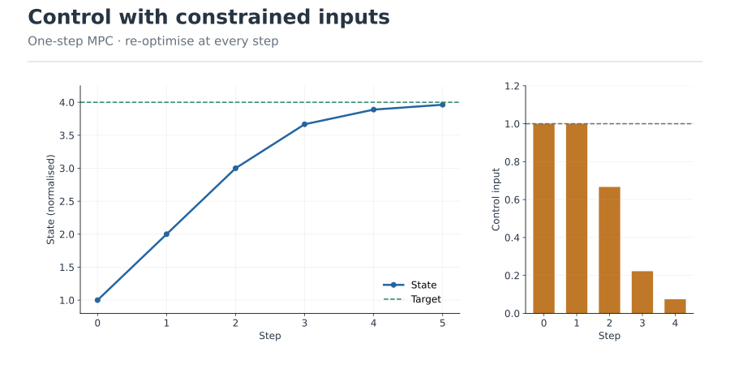

# M29-L4 – Planning, Control and Model Predictive Approaches {#L4}

**Course area:** M29 – Robotics and Autonomous Systems

**Level:** Master · Compulsory elective/applications

**Prerequisites:** M18, M22, M25.

**Learning objective:** Distinguish a path, a trajectory and feedback control, and derive a constrained predictive controller in a teaching model.

## From a goal to executable motion {#S1}

A destination alone does not specify how to move. A geometric path describes positions in space without assigning times; a trajectory additionally specifies time, speed or other state variables. A global planner uses a map and might search for a low-cost route with A*. A local planner adapts motion to current obstacles and physical constraints. For a vehicle with nonzero dimensions, obstacles must be assessed against the vehicle's whole footprint: a collision-free centre point is not enough. A feedback controller compares the measured state with a desired state and generates control inputs to reduce deviations. These layers typically operate at different update rates and may impose constraints on one another.

## One step of model predictive control {#S2}




*Figure: Control trajectory with bounded actuator.*

Model Predictive Control (MPC) optimises a sequence of control inputs over a finite prediction horizon, subject to dynamic, state and input constraints. Only the first input is applied; the calculation is repeated after the next measurement. A normalised teaching model $x_{k+1}=x_k+u_k$ uses dimensionless quantities to describe motion along one axis. The target position is $x^*=4$, the initial position is $x_0=1$, and the input bound is $|u|\le 1$. For a horizon of one step, we minimise

$$J(u)=(x_0+u-x^*)^2+0.5u^2.$$

Differentiation gives $3u-6$, with the unconstrained solution $u=2$. Under the input bound, the unique minimum is $u=1$, leading to $x_1=2$. Re-optimising yields $x_2=3$ and $x_3=11/3$. The graphic shows this sequence and its approach to the goal. This one-step model does not capture full vehicle dynamics; real systems require, for example, constraints on acceleration, steering angle, collisions and delays.

```python
import numpy as np
x=1.; path=[x]; commands=[]
for _ in range(5):
    u=float(np.clip((4-x)/1.5,-1,1))
    commands.append(u); x+=u; path.append(x)
assert np.allclose(path[:4],[1,2,3,11/3])
assert abs(path[-1]-4)<.05 and max(map(abs,commands))<=1
print(path)
```

## Horizon, feasibility and fallback {#S3}

Longer horizons allow more anticipatory decisions but require more computing time. An objective function may combine distance from the target, energy, jerk and risk-related costs. Hard constraints must be distinguished from soft penalties: a collision penalty with a finite weight does not categorically rule out collisions. The optimisation problem may be infeasible because the constraints conflict, or the solver may exceed its time limit. A controlled fallback mechanism must detect such cases and respond within verified operational limits. Robust MPC takes defined model uncertainties and disturbances into account; stability and recursive feasibility are additional properties, not automatic consequences of calling a method MPC.

## Exercise with solution {#S4}

**Task:** Start at $x_0=3.4$ with the same model. What is the next control input, and how large is the new deviation?

**Solution:** $u=(4-3.4)/1.5=0.4$, which lies within the bound. Then $x_1=3.8$ and the remaining deviation is $0.2$. Without saturation, the error ratio in this example is $1/3$ per step.

## Sources and further reading {#S5}

- [Lynch and Park (2017): Modern Robotics](https://modernrobotics.northwestern.edu/nu-gm-book-resource/) · chapter overview and descriptions for Chapters 2, 3, 10 and 11 opened
- [Tedrake: Underactuated Robotics – Trajectory Optimization](https://underactuated.mit.edu/trajopt.html) · teaching chapter opened
- [Tedrake: Underactuated Robotics](https://underactuated.mit.edu/) · contents overview of Policy Search and Feedback opened
