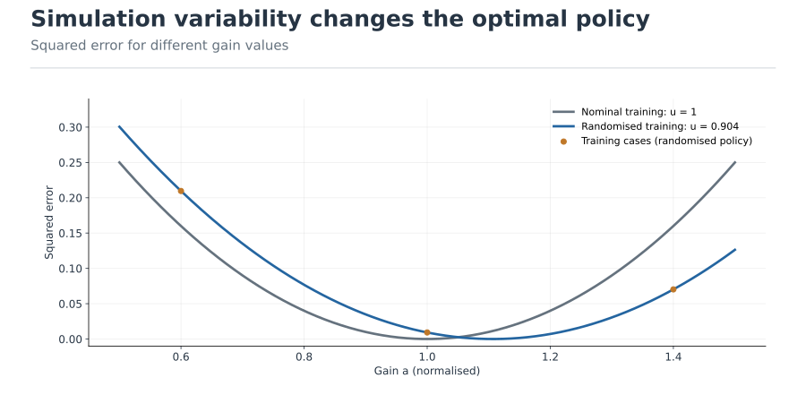

# M29-L5 – Robot Learning and Sim-to-Real Transfer {#L5}

**Course area:** M29 – Robotics and Autonomous Systems

**Level:** Master · Compulsory elective/applications

**Prerequisites:** M18, M22, M25.

**Learning objective:** Compare learning strategies in robotics and quantitatively examine the effect of varying simulation parameters.

## Learning in a feedback loop {#S1}

A robot may learn a control strategy from demonstrations (imitation learning), estimate a dynamical relationship from measurements (system identification), or improve a policy through sequences of actions and feedback (reinforcement learning; see M22). With imitation learning, deviations from the states observed in demonstrations can lead to further errors; with reinforcement learning, behaviour and risks depend on the reward function, exploration and permissible action space. Learning therefore does not automatically replace planning, state monitoring or an independent safety function. Hardware trials consume time and energy and cause wear; some failures are irreversible. Simulation offers a way of testing many scenarios without immediate physical consequences.

## Variation rather than an idealised simulation {#S2}




*Figure: How simulation variability affects the policy.*

The sim-to-real gap is the difference between simulated and real observations or dynamics. Domain randomisation varies, for example, friction, lighting, camera parameters and mass during training. To illustrate the idea, let $y=a u$ be a dimensionless linear motion with uncertain gain $a$. The target value is 1. We seek a constant command $u$ that minimises the empirical mean squared error for three equally weighted simulated gains $a=0.6;1;1.4$:

$$J(u)=\frac13\sum_{i=1}^3(a_i u-1)^2,\qquad u^*=\frac{\sum_i a_i}{\sum_i a_i^2}=\frac{3}{3.32}\approx0.9036.$$

The nominal model $a=1$ would choose $u=1$. Across the three training scenarios, mean error decreases from $0.1067$ to approximately $0.0964$. For a separately considered gain $a=1.2$, squared error with $u^*$ is approximately $0.00711$, rather than $0.04$. At $a=0.8$, however, it increases (approximately $0.0768$ rather than $0.04$). The graphic compares the two error curves. This example does not prove general robustness: it optimises an average, not the maximum error.

```python
import numpy as np
a=np.array([.6,1.,1.4]); u=a.sum()/(a@a)
loss=lambda a,u: np.mean((a*u-1)**2)
assert np.isclose(u,75/83) and loss(a,u)<loss(a,1.)
assert loss(np.array([1.2]),u)<.04 and loss(np.array([.8]),u)>.04
print(u,loss(a,1.),loss(a,u),loss(np.array([1.2]),u))
```

## Transfer and evidence {#S3}

Realistic randomisation requires plausible parameter ranges and relationships. Combining mass, friction and motor power in physically impossible ways may encourage inappropriate strategies. System identification or real calibration data can improve the simulation distribution. A staged evaluation begins with previously unseen simulated scenarios, uses hardware-in-the-loop where appropriate, and proceeds to controlled physical trials only within safeguarded operating limits. Execution time, peak energy demand, failure rates and rare scenarios should be recorded alongside mean rewards. Distribution shift and contact phenomena missing from the model remain possible even after successful randomisation.

## Exercise with solution {#S4}

**Task:** Which constant input minimises mean squared error when training uses only the equally weighted gains 0.5 and 1.5?

**Solution:** $u^*=(0.5+1.5)/(0.25+2.25)=0.8$. The mean error is $((0.4-1)^2+(1.2-1)^2)/2=0.2$, compared with $0.25$ for $u=1$. An individual state may still exhibit a larger error.

## Sources and further reading {#S5}

- [Tobin et al. (2017): Domain Randomization for Transferring Deep Neural Networks from Simulation to the Real World](https://arxiv.org/abs/1703.06907) · abstract opened
- [Tedrake: Underactuated Robotics](https://underactuated.mit.edu/) · contents overview of Policy Search and Feedback opened
