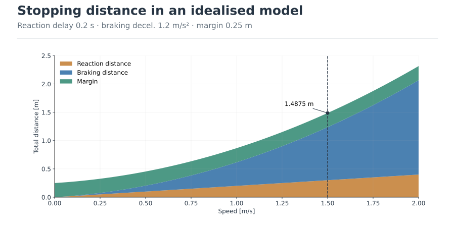

# M29-L6 – Safety Limits and Evaluation of Autonomous Systems {#L6}

**Course area:** M29 – Robotics and Autonomous Systems

**Level:** Master · Compulsory elective/applications

**Prerequisites:** M18, M22, M25.

**Learning objective:** Model operational limits and stopping distance, and assess what can be inferred from a finite number of safety trials.

## Autonomy under defined conditions {#S1}

An autonomous trolley may operate only within a defined operational domain. This includes floor conditions, gradients, lighting, permitted speed, visibility, communication conditions and proximity to people. Such limits are part of the safety argument. Hazards arise not only from collisions, but also from unexpected movement, crushing or trapping, falling loads and failure to provide assistance. Risk assessment must consider the entire operation and possible malfunctions. A learned perception system and an independent mechanism for detecting hazardous states can have different roles. An emergency stop is an additional measure, not a substitute for safe design. The calculation below is a synthetic teaching example only; it is neither a design specification nor an approval for actual machinery.

## Reaction distance and braking distance {#S2}




*Figure: Idealized stopping distance of a robot.*

A vehicle travels on level ground at $v=1.5\,\mathrm{m/s}$. The simplified model assumes a maximum total reaction delay $\tau=0.2\,\mathrm{s}$ followed by constant deceleration of magnitude $a=1.2\,\mathrm{m/s^2}$. Speed remains constant during the reaction delay. With an additional margin $b=0.25\,\mathrm{m}$, the result is

$$d(v)=v\tau+\frac{v^2}{2a}+b.$$

Reaction distance is $0.30\,\mathrm{m}$, braking distance is $0.9375\,\mathrm{m}$, and total distance is $1.4875\,\mathrm{m}$. The graphic displays these components for different speeds. The model does not directly cover moving obstacles, gradients, changing friction, acceleration during the delay or variable braking force. Real applications require substantiated conservative bounds, measurement uncertainties, and the reaction and approach movements of everyone involved.

```python
from math import sqrt,log
v,tau,a,b=1.5,.2,1.2,.25
stop=lambda v: v*tau+v*v/(2*a)+b
assert abs(stop(v)-1.4875)<1e-10
vmax=-a*tau+sqrt((a*tau)**2+2*a*(1-b))
assert abs(stop(vmax)-1)<1e-10
upper=1-.05**(1/100)
assert .029<upper<.030
print(stop(v),vmax,upper)
```

## Scenario-based evaluation {#S3}

A test plan defines scenarios, measurements, abort conditions and acceptance criteria before execution. In addition to task success, it should assess collisions, near misses, minimum clearances, localisation errors, failure responses and timing behaviour. NIST describes repeatable procedures for quantitatively assessing different capabilities of response robots. These provide a model for systematic testing, not a general certification standard for this teaching example. Observing zero failures does not imply zero risk: in 100 independent, identically distributed Bernoulli trials with no failures, the exact one-sided 95% upper confidence bound is $p_U=1-0.05^{1/100}\approx0.0295$, since $(1-p_U)^{100}=0.05$. This interpretation is not justified for dependent repetitions or unrepresentative scenarios. Extremely rare hazards cannot be excluded through short test series alone.

## Exercise with solution {#S4}

**Task:** What speed corresponds to only $1\,\mathrm{m}$ of available stopping distance in the idealised model above?

**Solution:** The positive root of $v\tau+v^2/(2a)=1-b$ is $v=-a\tau+\sqrt{(a\tau)^2+2a(1-b)}\approx1.123\,\mathrm{m/s}$. This is a mathematical model limit, not a permissible real-world speed. Approving a real system requires further evidence and compliance with the applicable requirements.

## Sources and further reading {#S5}

- [NIST: Standard Test Methods for Response Robots](https://www.nist.gov/el/intelligent-systems-division-73500/standard-test-methods-response-robots) · project description and test goals opened
- [Lynch and Park (2017): Modern Robotics](https://modernrobotics.northwestern.edu/nu-gm-book-resource/) · chapter overview and descriptions for Chapters 2, 3, 10 and 11 opened
- [Tedrake: Underactuated Robotics](https://underactuated.mit.edu/) · contents overview of Policy Search and Feedback opened
