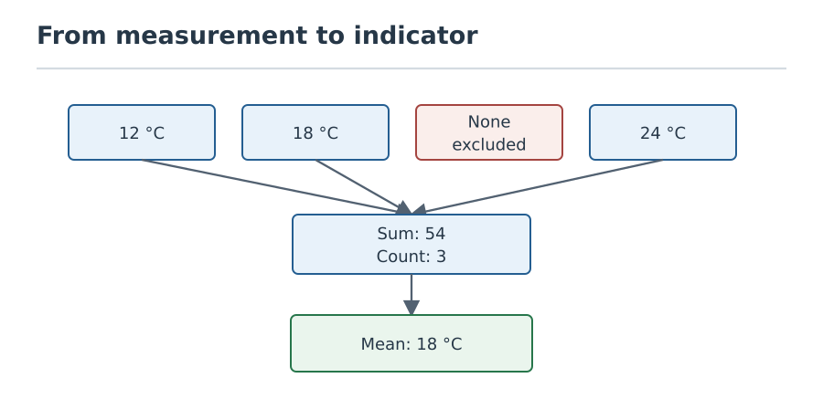

# M3-L1 – Python for data analysis and numerical computing {#L1}

**Course area:** M3 – Programming and data processing

**Level:** Bachelor · Core/Fundamentals

**Prerequisites:** M1; [M2-L1](M2-L1.md) is helpful.

**Learning objective:** Distinguish Python data structures and formulate a controlled numerical analysis as a function.

## Data and types {#S1}

A measurement station supplies the sequence 12, 18, missing, 24 (in °C). In Python, `None` stands for an absent value; it is not a number. A list preserves order and may contain different types. A tuple has immutable entries, while a dictionary associates keys with values. A dictionary is suitable, for example, for a measurement record with a station identifier and a temperature. A set contains unique elements without a guaranteed order relevant to the application. The choice of structure depends on how it is accessed, not just on its memory size.

## Writing a function for analysis {#S2}




*Figure: From measurement to indicator.*

We want to average only the measurements that are present. The function should not silently interpret an empty set of valid measurements as a temperature of zero.

```python
def mittelwert(werte):
    gueltig = [x for x in werte if x is not None]
    if not gueltig:
        raise ValueError("Keine Messwerte")
    return sum(gueltig) / len(gueltig)

werte = [12, 18, None, 24]
print(mittelwert(werte))  # 18.0
```

The list comprehension creates a new list. The condition is checked for every entry. The local variable `gueltig` exists independently of the original list; the function does not alter its contents. The denominator is 3, not 4. The decision to exclude missing values must be documented: if the sensor fails precisely when temperatures are high, the mean may be systematically too low.

## Numerical computing and limits of error handling {#S3}

NumPy is useful for homogeneous numerical arrays. `np.array([12, 18, 24], dtype=float)` creates an array of floating-point numbers. `mean()` calculates its mean. A library can execute the same calculation efficiently without changing its definition in the application domain. A Python integer can become much larger than a fixed-width integer in NumPy; the data type is therefore part of the data contract. The Python code shown checks only for `None`, not for strings, infinite values or `NaN`. Such cases must be checked explicitly in production data. Floating-point rounding ([M2-L7](M2-L7.md)) remains relevant even when using libraries.

## Exercise and solution {#S4}

A second station reports `[10, None, 20, 30]`. What does the function return? What happens with `[None]`? How could completeness also be determined?

Solution: 20.0; the second call raises a `ValueError`. For the first list, completeness is 3/4 = 75%. This indicator should be stored independently of the mean. The completeness rate is also undefined for an empty input list.

## Sources and further reading {#S5}

- [Python 3.14, Data Structures, Ch. 5](https://docs.python.org/3.14/tutorial/datastructures.html) – **Verification:** pending; access date recorded only in source register (2026-11-20); substantive check not evidenced.
- [NumPy 2.3, Broadcasting](https://numpy.org/doc/2.3/user/basics.broadcasting.html) – **Verification:** pending; access date recorded only in source register (2026-11-20); substantive check not evidenced.
