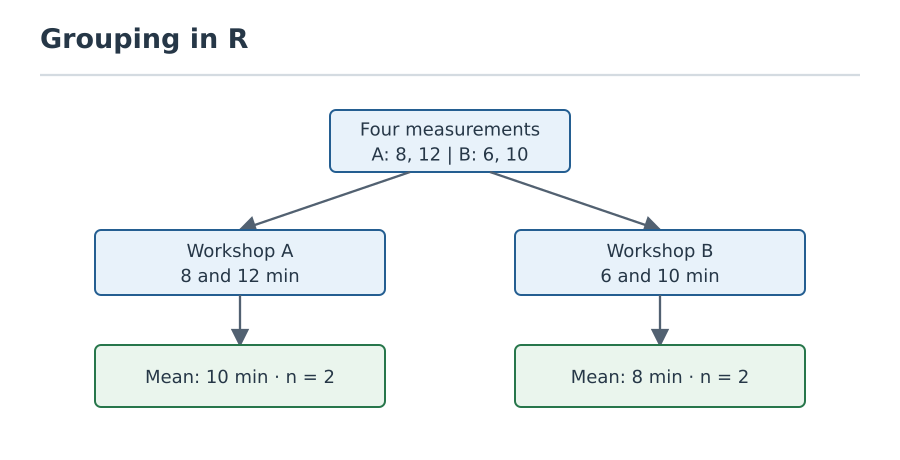

# M3-L2 – R for statistics and data analysis {#L2}

**Course area:** M3 – Programming and data processing

**Level:** Bachelor · Core/Fundamentals

**Prerequisites:** M1; [M3-L1](M3-L1.md) is helpful.

**Learning objective:** Use R vectors and data frames, and handle missing values and group analyses explicitly.

## R as a statistical working environment {#S1}

R is designed for analysis, modelling and visualisation. An atomic vector contains elements of a common type. `c(7, 11, NA, 15)` creates a numerical vector with one missing entry. `NA` is not the number zero; many calculations themselves return `NA` when a value is missing unless its treatment has been specified. Unlike Python, R indexes vectors from 1. `x[1]` is the first element.

```r
x <- c(7, 11, NA, 15)
mean(x, na.rm = TRUE)  # 11
sum(!is.na(x))         # 3
```

Here the parameter `na.rm` means that missing entries are excluded before calculation. If all values are missing, the group should explicitly be treated as unsuitable for analysis rather than assuming a meaningful mean.

## Data frames and groups in the application domain {#S2}




*Figure: Grouping in R.*

A data frame has columns of equal length, which may have different types. We record four processing times in minutes for two workshops. With dplyr, the question can be expressed as a sequence of grouping and summarising operations. The additional package must be installed.

```r
library(dplyr)
d <- data.frame(werk = c("A", "A", "B", "B"),
                minuten = c(8, 12, 6, 10))
d |>
  group_by(werk) |>
  summarise(n = n(), mittel = mean(minuten), .groups = "drop")
```

The output contains A with two cases and 10 minutes, and B with two cases and 8 minutes. The pipe symbol `|>` passes the result of an expression as the first argument of the next function call. Grouping creates a new analysis here; it does not delete the original observations. In a new analysis, the resulting table should report not only a mean but also the corresponding count.

## Statistical meaning before syntax {#S3}

An overall mean is not automatically the mean of the group means. If A has two and B has four measurements, the four B values together carry twice as much weight as the two A values together in an analysis per measurement. If each workshop is to have the same weight instead, an unweighted mean of the group means is the appropriate alternative indicator. The purpose of the analysis determines the choice.

## Exercise and solution {#S4}

Workshop A has times of 8 and 12 minutes; B has 6, 10, 10 and 14 minutes. Calculate the overall mean and the equally weighted workshop mean. What distinguishes this example from a case with unequal workshop means?

Solution: Both group means are 10, so both indicators are also 10. If the last B value is changed from 14 to 20, the results are B = 11.5, overall mean = 11 and equally weighted workshop mean = 10.75. The equal results in the first case were not a general arithmetic rule.

## Sources and further reading {#S5}

- [R for Data Science (2e), Workflow: basics, Ch. 2](https://r4ds.hadley.nz/workflow-basics.html) – **Verification:** pending; access date recorded only in source register (2026-11-20); substantive check not evidenced.
- [R for Data Science (2e), Data transformation, Ch. 3](https://r4ds.hadley.nz/data-transform.html) – **Verification:** pending; access date recorded only in source register (2026-11-20); substantive check not evidenced.
