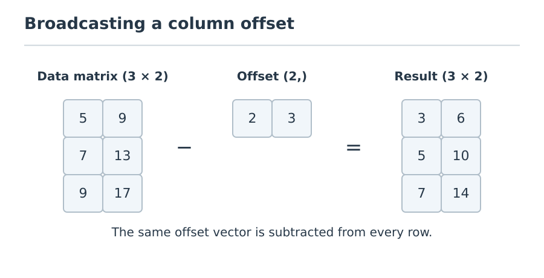

# M3-L3 – Arrays, vectorisation and broadcasting {#L3}

**Course area:** M3 – Programming and data processing

**Level:** Bachelor · Core/Fundamentals

**Prerequisites:** [M2-L1](M2-L1.md); [M3-L1](M3-L1.md).

**Learning objective:** Check array shapes and distinguish element-wise operations from matrix products.

## Computing along axes {#S1}

On a production line, two measured quantities are recorded for each of three components. A table with three rows and two columns can be represented as a NumPy array. An axis is a position within the array shape; in this application, axis 0 represents the components and axis 1 the measured quantities. `a.sum(axis=0)` aggregates the components and returns two sums. `a.sum(axis=1)` aggregates the measured quantities and returns three sums. The second result is meaningful only if the quantities can be added.

## Broadcasting as a shape rule {#S2}




*Figure: Broadcasting a column offset.*

A known offset is to be subtracted for each measured quantity. A vector with two components acts on every row:

```python
import numpy as np
a = np.array([[5, 9], [7, 13], [9, 17]])
b = np.array([2, 3])
c = a - b
print(c)  # [[3, 6], [5, 10], [7, 14]]
```

NumPy compares the dimensions from right to left. Two dimensions are compatible if they are equal or one of them is 1; missing dimensions on the left are treated as ones. Thus `(3, 2)` and `(2,)` are compatible. The expansion of the vector is conceptual; NumPy does not have to create three physical copies of it. A resulting array may nevertheless occupy a great deal of memory. A vector of shape `(3,)`, in contrast, is not compatible with `(3, 2)`. If one common offset is to apply to each row, shape `(3, 1)` is needed.

## Vectorisation, copies and products {#S3}

For numerical arrays, vectorisation shifts many element-wise operations from Python loops into optimised library functions. It does not promise constant runtime: the number of elements processed still matters. Intermediate results can increase memory requirements. A slice such as `a[:, 0]` is a view of the original values in this array; changes may affect the original. If needed, `.copy()` creates independent data. `a * b` performs element-wise multiplication, while `a @ b` forms row-wise dot products (see [M2-L1](M2-L1.md)).

## Exercise and solution {#S4}

Calculate `a - np.array([[1], [2], [3]])` and `a @ b`. What shapes do the results have?

Solution: The first operation yields `[[4, 8], [5, 11], [6, 14]]` with shape `(3, 2)`. The matrix-vector product yields `[37, 53, 69]` with shape `(3,)`. The multiplication sums weighted row entries, while broadcasting subtracts one value in each row. For square arrays, check particularly carefully whether a compatible vector actually corresponds to the intended axis.

## Sources and further reading {#S5}

- [NumPy 2.3, Broadcasting](https://numpy.org/doc/2.3/user/basics.broadcasting.html) – **Verification:** pending; access date recorded only in source register (2026-11-20); substantive check not evidenced.
- [NumPy 2.3, Copies and views](https://numpy.org/doc/2.3/user/basics.copies.html) – **Verification:** pending; access date recorded only in source register (2026-11-20); substantive check not evidenced.
