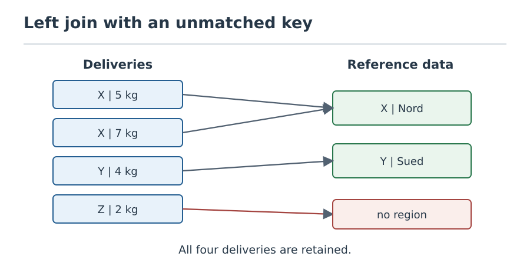

# M3-L4 – Grouping, filtering and joining tabular data {#L4}

**Course area:** M3 – Programming and data processing

**Level:** Bachelor · Core/Fundamentals

**Prerequisites:** [M3-L1](M3-L1.md); [M3-L2](M3-L2.md) is helpful.

**Learning objective:** Apply table operations using keys, groups and controlled cardinalities.

## Tables as relationships {#S1}

One table stores individual deliveries, while a second holds warehouse reference data. A delivery ID identifies a delivery; the warehouse ID may appear several times in the delivery table. In the reference table, however, it identifies exactly one warehouse. This creates a many-to-one relationship. Row positions are not stable identities because sorting and filtering can change them.

## Joining and filtering {#S2}




*Figure: Left join with an unmatched key.*

```python
import pandas as pd
l = pd.DataFrame({"lager": ["X", "X", "Y", "Z"],
                  "kg": [5, 7, 4, 2]})
s = pd.DataFrame({"lager": ["X", "Y"],
                  "region": ["Nord", "Sued"]})
d = l.merge(s, on="lager", how="left",
            validate="many_to_one", indicator=True)
print(d.loc[d["_merge"] == "left_only", "lager"].tolist())
# ['Z']
```

A left join preserves all deliveries. Warehouse Z has no matching reference record; its region field is missing. An inner join would omit Z. `validate` guards against unexpectedly repeated reference keys. Care is needed with missing keys: pandas can join missing keys to each other, unlike typical SQL equality joins. A careful data contract prohibits missing or ambiguous reference keys or defines separate rules for them.

## Grouping, aggregating and checking {#S3}

The following code block uses the `d` table created in the preceding example. Run the two examples in sequence.

```python
resultat = (d.groupby("region", dropna=False)["kg"]
             .agg(["sum", "size"]))
```

Nord (North) has a sum of 12 and a count of 2; Sued (South) has a sum of 4 and a count of 1; the unknown region has a sum of 2 and a count of 1. The overall quantity remains 18 kg. A filter such as `d.loc[d["kg"] >= 5]` returns two rows; it changes the set under consideration. A group summary, by contrast, changes the granularity: deliveries become regions. With several grouping keys, one row is formed for each combination. A pivot can arrange these results as a cross-tabulation, but is not an additional observation. Key counts, row counts and appropriate control totals should be compared before and after a join.

## Exercise and solution {#S4}

Suppose the reference data contain a second record for X. How many rows does the unchecked left join produce? What sum results? What happens with validation?

Solution: The two X deliveries each appear twice; together with Y and Z, this produces six rows. The sum becomes 30 kg instead of 18 kg. `validate="many_to_one"` rejects the join. The correct remedy requires clarification of the meaning of the key in the application domain, not the indiscriminate deletion of arbitrary result rows.

## Sources and further reading {#S5}

- [pandas, Merge, join, concatenate and compare](https://pandas.pydata.org/docs/user_guide/merging.html) – **Verification:** pending; access date recorded only in source register (2026-11-20); substantive check not evidenced.
- [pandas, Group by: split-apply-combine](https://pandas.pydata.org/docs/user_guide/groupby.html) – **Verification:** pending; access date recorded only in source register (2026-11-20); substantive check not evidenced.
