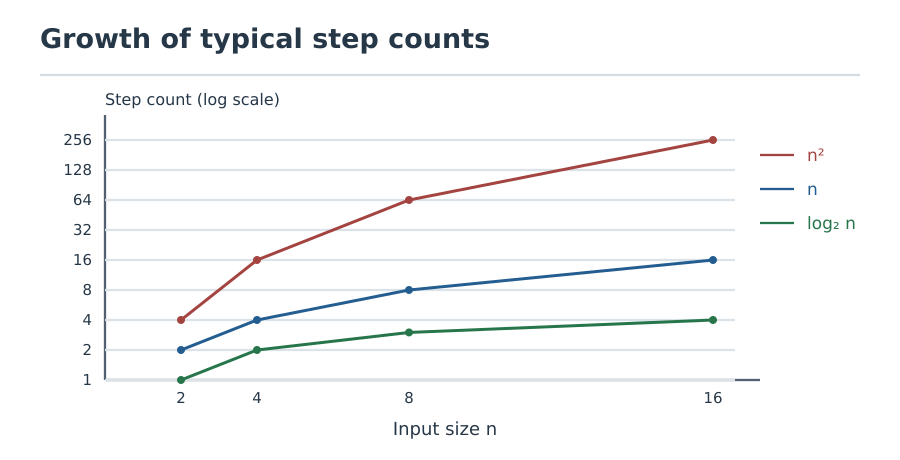

# M3-L5 – Algorithms, complexity and memory requirements {#L5}

**Course area:** M3 – Programming and data processing

**Level:** Bachelor · Core/Fundamentals

**Prerequisites:** [M3-L1](M3-L1.md); [M3-L3](M3-L3.md).

**Learning objective:** Compare orders of growth, justify search strategies and estimate memory requirements.

## The cost of a procedure {#S1}




*Figure: Growth of typical step counts.*

An algorithm is a specified procedure that solves a task in a finite number of steps, provided its preconditions hold. When searching for a value in an unsorted list, all $n$ entries must be read in the worst case. The cost grows linearly: $O(n)$. An already sorted list permits binary search: a comparison with the middle element approximately halves the remaining range. In the worst case, at most $\lfloor\log_2 n\rfloor+1$ comparisons with list elements are needed (for $n\ge1$ in conventional exact binary search). The order is $O(\log n)$.

## Search strategy and overall cost {#S2}

```python
from bisect import bisect_left
werte = [3, 8, 12, 19, 24, 31, 42, 55]
pos = bisect_left(werte, 24)
gefunden = pos < len(werte) and werte[pos] == 24
print(pos, gefunden)  # 4 True
```

`bisect_left` determines an insertion position, not directly whether the value exists; the extra check verifies a match. The procedure requires sorted inputs. If sorting is performed once and searches are then very frequent, the preparation may pay off. For a few queries, linear search may be cheaper. For a list with ongoing additions that was initially unsorted, maintaining its sorted order must be taken into account; insertion into a contiguous array may require shifting $O(n)$ entries. A hash index is another option, typically with constant expected search cost, but with additional memory and collision costs.

## Estimating memory requirements {#S3}

A dense matrix with $n=100\,000$ rows and $d=50$ columns contains five million values. With 64-bit floating-point numbers, eight bytes per value are needed:

$$B=8nd=40\,000\,000\ \text{Byte}.$$

That is 40 MB in decimal units, approximately 38.15 MiB in binary units, plus administrative data. A dense pairwise distance matrix of the rows, in contrast, would have $n^2$ values, or 80 GB in decimal units. Blockwise processing can avoid keeping all distances in memory simultaneously. It does not necessarily save computational work, however. Actual runtime also depends on hardware, data layout and implementation; Big-O describes asymptotic growth, not seconds.

## Exercise and solution {#S4}

How do linear and quadratic steps grow if $n$ is doubled? How many data bytes does the original matrix require with `float32`?

Solution: The leading linear count doubles, while the quadratic count quadruples. Four bytes per value give 20 million bytes, or 20 MB. The lower precision must be appropriate for the task.

## Sources and further reading {#S5}

- [Python 3.14, bisect — Array bisection algorithm](https://docs.python.org/3.14/library/bisect.html) – **Verification:** pending; access date recorded only in source register (2026-11-20); substantive check not evidenced.
