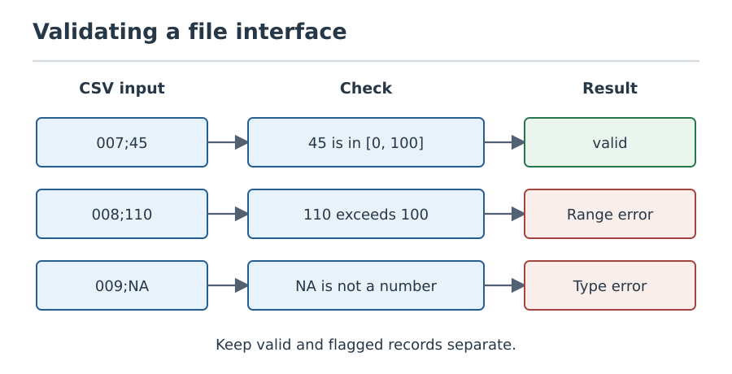

# M3-L6 – Data formats, file interfaces and validation {#L6}

**Course area:** M3 – Programming and data processing

**Level:** Bachelor · Core/Fundamentals

**Prerequisites:** [M3-L1](M3-L1.md); [M3-L4](M3-L4.md).

**Learning objective:** Choose data formats according to structure and check inputs in several stages before analysis.

## Representation and contract {#S1}

CSV is a row-oriented tabular representation; delimiter, character encoding, decimal notation and quoting are part of the interface. JSON can carry nested objects and lists, but has no date type of its own. Binary column-oriented formats such as Parquet are suitable for many analytical workloads because they support type information and column-wise access. This does not imply universal superiority: small exchange files often need an easily inspected text representation. A file format alone does not ensure quality in the application domain.

## Parsing and semantic validation {#S2}




*Figure: Validating a file interface.*

A fictional interface supplies a station number and relative humidity as a percentage. First the CSV is read syntactically; the type and range are then checked. Station identifiers remain strings so that leading zeroes are preserved.

```python
import csv
from io import StringIO
text = "station;feuchte\n007;45\n008;110\n009;NA\n"
gut, fehler = [], []
reader = csv.DictReader(StringIO(text), delimiter=";")
if reader.fieldnames != ["station", "feuchte"]:
    raise ValueError("Unerwartete Spalten")
for zeile in reader:
    try:
        if set(zeile) != {"station", "feuchte"} or not zeile["station"]:
            raise ValueError("Struktur oder Kennung")
        f = float(zeile["feuchte"])
        if not 0 <= f <= 100:
            raise ValueError("Wertebereich")
        gut.append((zeile["station"], f))
    except (TypeError, ValueError):
        fehler.append(zeile)
```

One row is valid (`007`, 45.0); two are flagged. Under the agreed strict interface, `NA` is an error; under another contract it might be an explicitly permitted missing value. Rows containing errors are kept separately, rather than silently being set to a limit. Checking syntax, checking data types and assessing plausibility in the application domain are different steps. This demonstration is not a complete parser for arbitrary external data.

## Data exchange in operation {#S3}

A file interface also requires a documented schema version, expected columns, units and rules for missing data. An API can transfer similar data as JSON; timestamps, status codes, retries and pagination are defined by the contract. For external data, size, nested structures and resource consumption are limited. JSON may be read as a data format, not interpreted as executable program text. Hashes can establish that a specific input file is unchanged, not that its content is true.

## Exercise and solution {#S4}

Add `010;0`, `011;100` and `012;nan`. Which new rows pass the range check?

Solution: 0 and 100 are inclusive limits, so both rows are valid. Although `nan` can be interpreted as a floating-point number, it does not satisfy the comparison. After the additions, three rows are valid and three are flagged. A separate error column could distinguish between type, structure and range errors.

## Sources and further reading {#S5}

- [Python 3.14, csv — CSV File Reading and Writing](https://docs.python.org/3.14/library/csv.html) – **Verification:** pending; access date recorded only in source register (2026-11-20); substantive check not evidenced.
- [Python 3.14, json — JSON encoder and decoder](https://docs.python.org/3.14/library/json.html) – **Verification:** pending; access date recorded only in source register (2026-11-20); substantive check not evidenced.
- [Apache Parquet, Overview](https://parquet.apache.org/docs/overview/) – **Verification:** pending; access date recorded only in source register (2026-11-20); substantive check not evidenced.
