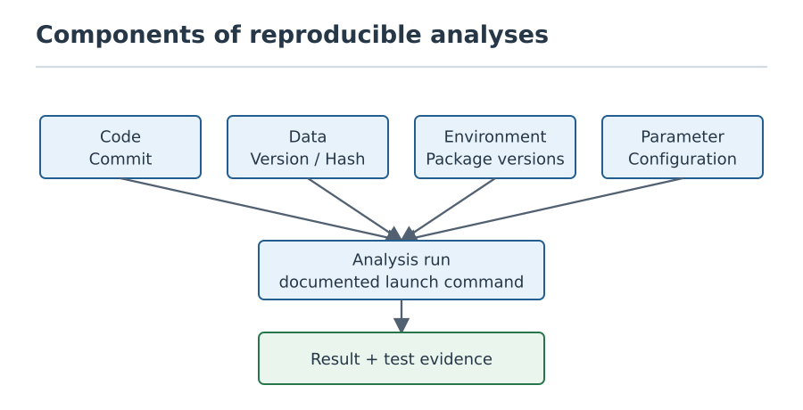

# M3-L7 – Tests, version control and reproducible environments {#L7}

**Course area:** M3 – Programming and data processing

**Level:** Bachelor · Core/Fundamentals

**Prerequisites:** [M3-L1](M3-L1.md); [M3-L6](M3-L6.md).

**Learning objective:** Define test cases and record the program, data, execution environment and parameters in a traceable way.

## Specifying expected behaviour {#S1}

A result is not reliable merely because a script finishes without an error message. A function that summarises delivery quantities must return expected outputs for known inputs. A typical test checks normal cases, boundary cases and invalid inputs. For floating-point numbers, the tolerance should be justified in the application domain; exact equality is not always meaningful. Tests check the specified properties, but do not automatically prove the absence of all errors.

## A minimal automated test {#S2}

```python
import unittest

def gesamt(mengen):
    if any(x < 0 for x in mengen):
        raise ValueError("Negative Menge")
    return sum(mengen)

class TestGesamt(unittest.TestCase):
    def test_normal(self):
        self.assertEqual(gesamt([4, 6]), 10)
    def test_leer(self):
        self.assertEqual(gesamt([]), 0)
    def test_negativ(self):
        with self.assertRaises(ValueError):
            gesamt([4, -1])

if __name__ == "__main__":
    unittest.main()
```

Saved as `test_gesamt.py`, the file can be run with `python -m unittest test_gesamt`. Here, a list of valid numbers is assumed; iterators or non-finite values are not part of this small contract. Unlike the mean, the sum of an empty list is defined as zero, the identity element. Integration tests additionally check interactions, such as the process from reading a file through to outputting an indicator.

## Reproducible execution {#S3}




*Figure: Components of reproducible analyses.*

Version control documents changes to source code. A Git commit identifies a specific project state; a tag can mark an approved version. Data that are not stored in Git need their own version or content hash. An isolated environment (`python -m venv .venv`) separates project dependencies. For a repeat run, document the Python version, package versions including transitive dependencies where possible, operating system, parameters, data version and launch command. `pip freeze` can record installed versions, but does not replace a complete cross-platform lock with artefact hashes. A fixed random seed can control random sequences; parallel execution, hardware or changed libraries may nevertheless produce different results.

## Exercise and solution {#S4}

Write an additional test for `[0, 0]`. Why is it not sufficient to archive only the commit?

Solution: `self.assertEqual(gesamt([0, 0]), 0)` checks two explicit zero quantities. The commit may contain neither the input file used nor the library versions, parameters or system environment. These data must be documented separately and associated unambiguously with the analysis.

## Sources and further reading {#S5}

- [Python 3.14, unittest — Unit testing framework](https://docs.python.org/3.14/library/unittest.html) – **Verification:** pending; access date recorded only in source register (2026-11-20); substantive check not evidenced.
- [Python 3.14, Virtual Environments and Packages, Ch. 12](https://docs.python.org/3.14/tutorial/venv.html) – **Verification:** pending; access date recorded only in source register (2026-11-20); substantive check not evidenced.
- [Pro Git, 2.2 Recording Changes to the Repository](https://git-scm.com/book/en/v2/Git-Basics-Recording-Changes-to-the-Repository) – **Verification:** pending; access date recorded only in source register (2026-11-20); substantive check not evidenced.
