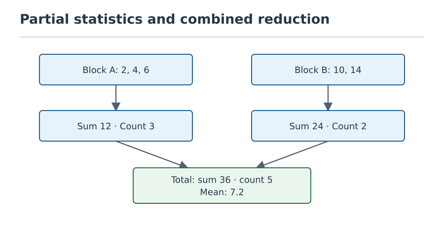

# M3-L8 – Functional programming and concurrent data processing {#L8}

**Course area:** M3 – Programming and data processing

**Level:** Bachelor · Elective specialisation

**Prerequisites:** [M3-L1](M3-L1.md) to [M3-L7](M3-L7.md).

**Learning objective:** Formulate processing of data partitions with few side effects and distinguish concurrency from parallelism.

## Functions as building blocks {#S1}

A pure function returns the same value for the same input and does not change any externally observable state. A data process can often be divided into small functions: validate, convert, aggregate. Side effects such as file access or logging are kept at clearly named interfaces. This makes testing easier; complete purity is not always practical in real programs. Generators can supply data incrementally, so not every intermediate value needs to be in memory at the same time.

## Processing data partitions independently {#S2}




*Figure: Partial statistics and combined reduction.*

A series of measurements is divided into two blocks. For each block, we calculate its sum and count. A thread pool can manage independent tasks concurrently; here, `map` returns the results in input order.

```python
from concurrent.futures import ThreadPoolExecutor

def teile_statistik(block):
    return sum(block), len(block)

bloecke = [[2, 4, 6], [10, 14]]
with ThreadPoolExecutor(max_workers=2) as pool:
    teile = list(pool.map(teile_statistik, bloecke))
summe = sum(s for s, n in teile)
anzahl = sum(n for s, n in teile)
print(summe / anzahl)  # 7.2
```

The partial results are (12, 3) and (24, 2). They yield the correct mean of 36/5. The unweighted mean of the block means would be 8 and therefore incorrect. An empty overall input would need to be handled before division. Blockwise summation of floating-point values may change the rounding. The reduction order can therefore be part of reproducibility.

## Concurrency, parallelism and costs {#S3}

Concurrency allows several tasks to be organised with overlapping activity; parallelism means actual simultaneous execution. Threads are often suitable for waiting during input/output operations. For CPU-intensive Python code, separate processes are often more suitable in a conventional CPython build with the GIL; library operations may release the GIL, and free-threaded builds have different properties. Processes incur costs for startup, communication and data transfer. Shared mutable state can cause race conditions if the result depends on the execution order. Independent blocks and local results avoid many such problems. The example pool demonstrates the interface, not a speed improvement.

## Exercise and solution {#S4}

A third block contains `[20]`. Determine the overall mean without combining the raw data. Why is a thread pool not automatically faster?

Solution: The new partial pair is (20, 1). Sum 56, count 6, mean $56/6\approx9.33$. For small tasks, management overhead may dominate; for CPU-intensive Python code, additional threads may also be constrained by the GIL. Comparative measurements using representative data determine the answer.

## Sources and further reading {#S5}

- [Python 3.14, Functional Programming HOWTO](https://docs.python.org/3.14/howto/functional.html) – **Verification:** pending; access date recorded only in source register (2026-11-20); substantive check not evidenced.
- [Python 3.14, concurrent.futures — Launching parallel tasks](https://docs.python.org/3.14/library/concurrent.futures.html) – **Verification:** pending; access date recorded only in source register (2026-11-20); substantive check not evidenced.
