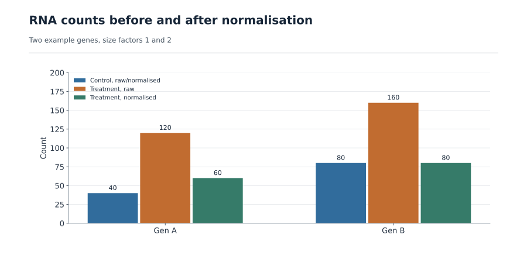

# M30-L1 – Bioinformatics and Omics Data {#L1}

**Course area:** M30 – Data Science in Science and Society

**Level:** Master · Compulsory elective/applications

**Prerequisites:** M20, M21, M27, M28.

**Learning objective:** Normalise omics measurements, model differences in expression and explain the limitations of biological interpretation.

## Molecular measurements and study design {#S1}

Omics approaches measure many molecular features simultaneously. Genomics data, for example, describe DNA variants; transcriptomics data describe RNA abundance; proteomics data describe proteins; and metabolomics data describe small molecules. The observation unit is the biological sample, not the individual gene. Repeated measurements of the same sample do not replace independent biological replicates. After sequencing fragments have been assigned in RNA sequencing, the resulting matrix $K_{ij}$ has genes $i$ and samples $j$. Raw counts depend on sequencing depth, sample quality and technical processing as well as expression. Before analysis, sample identifiers, reference genome, technical batches and groups must be comparable. Where batch is completely confounded with group, the two effects cannot be separated analytically.

## Normalisation and differential expression {#S2}




*Figure: RNA read counts before and after normalization.*

A simple teaching example uses two genes, A and B, and two samples. In the control, 40 and 80 fragments are counted; in the treatment, the counts are 120 and 160. Assume that independent reference measurements yield relative size factors of 1 and 2. The normalised counts are then (40, 80) and (60, 80). The log fold change of gene A is $\log_2(60/40)\approx0.585$, while that of B is zero. The apparent tripling of A is therefore partly explained by sequencing depth.

A realistic model often uses a negative binomial distribution for the counts, with $E[K_{ij}]=\mu_{ij}$ and $\operatorname{Var}(K_{ij})=\mu_{ij}+\alpha_i\mu_{ij}^2$. A regression can set $\log\mu_{ij}=\log s_j+\beta_{i0}+\beta_{i1}x_j$, where $s_j$ is the size factor and $x_j$ is the group indicator. With the natural logarithm, $\beta_{i1}/\log 2$ is the log2 fold change. The offset is not treated as a freely estimated group coefficient. In practice, size factors and dispersion are estimated using many genes and/or replicates, rather than two isolated raw counts.

```python
import numpy as np
K=np.array([[40,120],[80,160]])
norm=K/np.array([1,2])
lfc=np.log2(norm[:,1]/norm[:,0])
assert np.allclose(lfc,[np.log2(1.5),0])
print(norm,lfc)
```

## From significance to biological evidence {#S3}

When thousands of tests are performed, adjusted p-values, for example using Benjamini–Hochberg (M6), are important alongside effect size and uncertainty. A small adjusted p-value does not establish the mechanistic function of a gene. Subsequent pathway testing must account for a meaningful background set and dependencies. For predictive models, samples from the same patient belong exclusively in one data partition, and feature selection takes place within training. In single-cell measurements, many cells from one donor do not constitute the same number of independent people. Genetic data can be highly sensitive; provenance, access and consent form part of data management.

## Exercise with solution {#S4}

**Task:** A third gene has raw counts of 20 and 80, with the same size factors. Calculate its normalised fold change and log2 fold change.

**Solution:** The normalised counts are 20 and 40, giving a ratio of 2 and $\log_2 2=1$. No significance test can be derived from this individual comparison.

## Sources and further reading {#S5}

- [Bioconductor: Analyzing RNA-seq data with DESeq2](https://www.bioconductor.org/packages/release/bioc/vignettes/DESeq2/inst/doc/DESeq2.html) · the section The DESeq2 model was opened
