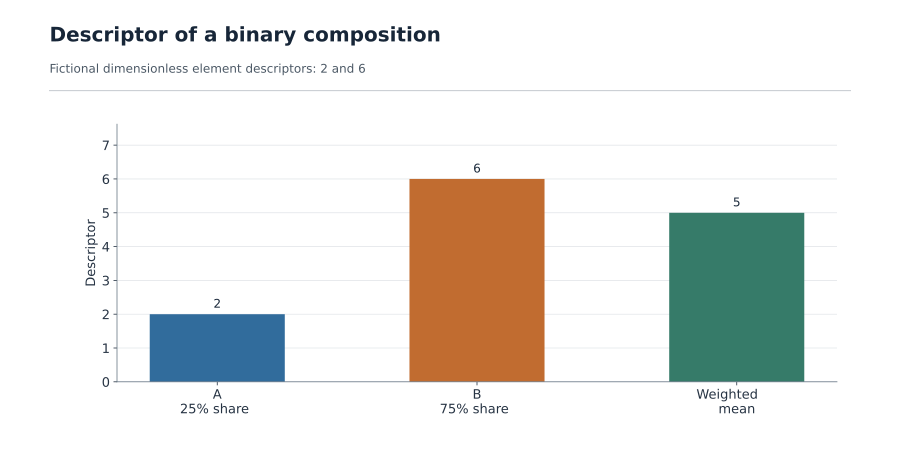

# M30-L10 – Chemistry, Materials Science and Data-Driven Material Models {#L10}

**Course area:** M30 – Data Science in Science and Society

**Level:** Master · Elective specialisation

**Prerequisites:** M20, M21, M27, M28.

**Learning objective:** Choose representations for materials data, compute mixture descriptors and test structural generalisation.

## Molecules, crystals and material properties {#S1}

Data-driven chemistry and materials science combine measurements, quantum-mechanical simulation and data-based models. A molecule may be represented as a graph of atoms and bonds; for crystals, periodic neighbours and lattices must be considered. Composition vectors are simpler, but contain neither molecular geometry nor crystal structure. Property values are only comparable when measurement conditions match: temperature, pressure, sample preparation, measurement technique and units may all matter. Different simulation levels or laboratories can produce systematically different values. A useful representation must preserve the symmetries and physical information relevant to the target quantity.

## Composition descriptor in a teaching example {#S2}




*Figure: Composition-weighted material descriptor.*

For a fictional binary composition with proportions $c_A=0.25$, $c_B=0.75$ and dimensionless element descriptors $d_A=2$, $d_B=6$, the mean descriptor is $\bar d=\sum_i c_i d_i=5$. Its weighted dispersion is $v_d=\sum_i c_i(d_i-\bar d)^2=3$. Both are invariant to a mere reordering of the list of elements. A model $\hat y=10+2\bar d$ yields the entirely fictitious property value 20. This formula is deliberately not a material law: a mean descriptor cannot distinguish structures and phases that have different properties. Graph-based models for molecules or crystals may incorporate bonds, distances and local environments; suitable scalar target quantities should be invariant under translation and rotation.

```python
import numpy as np
c=np.array([.25,.75]); d=np.array([2.,6.])
m=c@d; v=c@((d-m)**2); y=10+2*m
assert np.isclose(c.sum(),1) and np.allclose([m,v,y],[5,3,20])
print(m,v,y)
```

## Benchmarks and laboratory validation {#S3}

Data splits must reflect the research goal. When predicting new molecular families, scaffold-based splits can be more suitable than random splits; in materials science, composition families, structural types or chronological discovery sequences can be held out. Duplicate entries and near-identical structural variants threaten independence. Matbench is one example of a benchmark for material property prediction. Robust evaluation includes baseline methods, uncertainty, checks outside the training domain and, where possible, independent experimental replication. A high predicted property establishes neither manufacturability nor stability or safety of a new material.

## Exercise with solution {#S4}

**Task:** Compute the mean and weighted dispersion for a mixture containing equal proportions of the two element descriptors.

**Solution:** $\bar d=4$ and $v_d=0.5(2-4)^2+0.5(6-4)^2=4$. The changed dispersion shows that the mean alone does not summarise every feature.

## Sources and further reading {#S5}

- [Dunn et al. (2020): Benchmarking Materials Property Prediction Methods](https://arxiv.org/abs/2005.00707) · abstract opened
