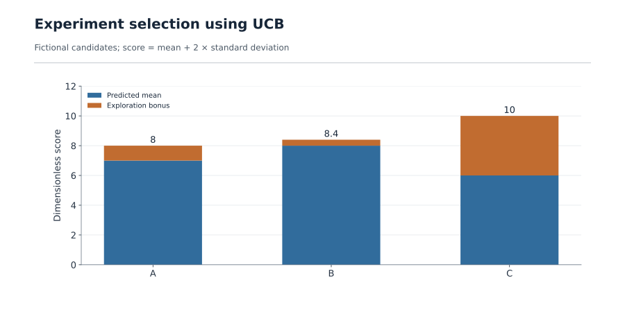

# M30-L11 – AI for Scientific Discovery and Hypothesis-Driven Experiments {#L11}

**Course area:** M30 – Data Science in Science and Society

**Level:** Master · Elective specialisation

**Prerequisites:** M20, M21, M27, M28.

**Learning objective:** Plan adaptive experiments using an acquisition function and distinguish computational hypothesis generation from confirmation.

## AI as a tool for scientific discovery {#S1}

Scientific experiments are often expensive: a laboratory can measure only a few samples per day, while a simulation may require many computing hours. Rather than investigate every candidate, a surrogate model is trained on existing measurements. Active learning chooses further data to improve a knowledge or modelling task, while Bayesian optimisation directs the selection towards an optimisation objective (M18, M23). These approaches can overlap. A model may also suggest hypotheses about mechanisms or relationships. Such suggestions do not automatically constitute discoveries: a hypothesis formulated in advance needs measurable and falsifiable consequences.

## Exploration and exploitation in a numerical example {#S2}




*Figure: Upper confidence bound for experiment selection.*

Three harmless, fictional simulation parameters A, B and C are candidates. A surrogate predicts dimensionless target means $\mu=(7,8,6)$ and standard deviations $\sigma=(0.5,0.2,2)$. We maximise an illustrative upper confidence bound (UCB) score $a(x)=\mu(x)+\kappa\sigma(x)$ with $\kappa\geq0$. When $\kappa=0$, B would be the first choice. With $\kappa=2$, the scores are 8, 8.4 and 10; C is chosen because of its uncertainty. The surrogate must be updated after the measurement. For a normal distribution, an upper quantile limit can be represented using a suitable quantile multiplier; an arbitrarily chosen UCB, however, is not a guaranteed confidence bound. The choice of $\kappa$ determines the relative importance of exploration here and does not guarantee finding the global optimum.

```python
import numpy as np
mu=np.array([7.,8.,6.]); sigma=np.array([.5,.2,2.])
score=mu+2*sigma
assert np.allclose(score,[8,8.4,10]) and score.argmax()==2
assert mu.argmax()==1
print(score)
```

## From adaptive screening to confirmation {#S3}

Before searching, specify admissible candidates, budget, measurement process, quality rules and target metric. After every measurement, record unsuccessful attempts and deviations too. Safety and feasibility limits must not be overridden by a high acquisition score. With multiple objectives, a Pareto set may be more useful than a single maximum. Repeatedly selecting the best candidate from noisy data can introduce winner's bias. After exploratory selection, an independent confirmatory experiment with a prespecified analysis is therefore necessary; adaptive interim analyses require suitable statistical procedures. AI may reduce experiment costs, but scientific explanations require additional tests of competing hypotheses, uncertainty and reproducibility.

## Exercise with solution {#S4}

**Task:** Calculate the UCB scores when κ=0.5. Which candidate is now selected?

**Solution:** A: 7.25; B: 8.1; C: 7. B is selected. The change follows from giving uncertainty less weight.

## Sources and further reading {#S5}

- [Di Fiore, Nardelli and Mainini (2024): Active Learning and Bayesian Optimization](https://link.springer.com/article/10.1007/s11831-024-10064-z) · introduction and classification opened
