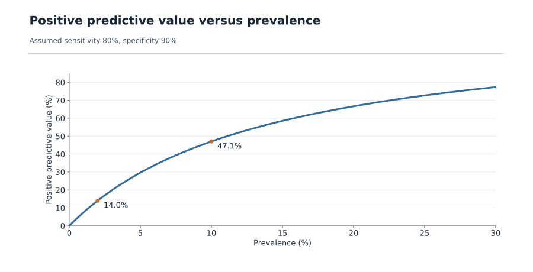

# M30-L2 – Medical Data and Clinical Model Validation {#L2}

**Course area:** M30 – Data Science in Science and Society

**Level:** Master · Compulsory elective/applications

**Prerequisites:** M20, M21, M27, M28.

**Learning objective:** Assess clinical model performance under changes in prevalence and plan independent evaluation.

## Clinical question and data limitations {#S1}

A predictive model is intended to estimate the occurrence of a specified event within 30 days at a fictional hospital. The prediction time must be fixed: laboratory results obtained after the event must not be used as inputs. Electronic health records contain repeated admissions, missing measurements, billing information and data resulting from treatment decisions. The absence of a test can itself be associated with a patient's clinical condition. Diagnosis (a current event) and prognosis (a future event) have different target definitions. Censored event times require methods from M17. Randomly splitting individual rows can distribute one person's data across training and test sets; partitions by patient and separate temporal or institutional evaluations are preferable.

## Prevalence and predictive values {#S2}




*Figure: Positive predictive value under changing prevalence.*

In a wholly synthetic example, a test has sensitivity $Se=0.8$ and specificity $Sp=0.9$. For prevalence $p$, the positive predictive value is
$$PPV=\frac{Se\,p}{Se\,p+(1-Sp)(1-p)}.$$
With 1,000 people and $p=0.1$, there are 80 true positives and 90 false positives; $PPV=80/170\approx0.471$. With $p=0.02$, the same conditional rates would yield 16 true positives and 98 false positives, giving $PPV\approx0.140$. This calculation assumes constant sensitivity and specificity; both need to be remeasured if the patient mix changes. A high ROC-AUC alone says nothing about probability calibration or the number of unnecessary interventions at a particular threshold.

```python
import numpy as np
p=np.array([.1,.02]); se=.8; sp=.9
ppv=se*p/(se*p+(1-sp)*(1-p))
assert np.allclose(ppv,[80/170,16/114])
print(ppv)
```

## External evaluation and clinical decisions {#S3}

A frozen model is evaluated at another institution without readjusting it there. Eligibility criteria, time windows, data processing, discrimination, calibration, confidence intervals and performance differences between relevant groups must all be documented. Recalibration constitutes a model change and requires another independent evaluation. Decision analyses distinguish the benefits of true-positive decisions from the harm and effort of false-positive decisions. The TRIPOD+AI reporting guideline supports transparency; it replaces neither clinical effectiveness studies nor regulatory approval. This numerical example is not a medical test or treatment recommendation.

## Exercise with solution {#S4}

**Task:** Calculate the expected numbers of true-positive and false-positive results for 2,000 observations at 5% prevalence.

**Solution:** Of 100 events, 80 are detected; among the 1,900 non-events, 190 are false positives. PPV $=80/270\approx29.6\%$.

## Sources and further reading {#S5}

- [Collins et al. (2024): TRIPOD+AI statement](https://pubmed.ncbi.nlm.nih.gov/38626948/) · PubMed abstract and bibliographical details
