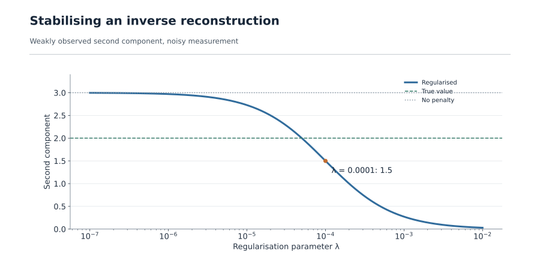

# M30-L3 – Physical Modelling and Inverse Problems {#L3}

**Course area:** M30 – Data Science in Science and Society

**Level:** Master · Compulsory elective/applications

**Prerequisites:** M20, M21, M27, M28.

**Learning objective:** Solve an ill-conditioned inverse problem and understand regularisation as a controlled bias–variance trade-off.

## Forward model and inverse problem {#S1}

In physics, the process mapping an unknown field to measurements is often known. For example, a sensor averages temperature along a path, losing fine structure. In discrete form this is $y=Ax+\varepsilon$, where $x$ is the quantity sought, $A$ is the measurement operator and $\varepsilon$ is measurement noise. The inverse problem seeks to determine $x$ from $y$. Small singular values of $A$ strongly amplify noise in particular directions. Rank deficiency also leaves some components non-identifiable. Even a perfect numerical solution to a physically incorrect forward model can give an incorrect result.

## Tikhonov regularisation in a two-component model {#S2}




*Figure: Regularization of an inverse reconstruction.*

For dimensionless teaching data, take $A=\operatorname{diag}(1,0.01)$ and the true solution $x=(1,2)^\top$. The measurement $y=(1,0.03)^\top$ contains an error of 0.01 in the second component. Direct inversion yields $(1,3)^\top$. For $\lambda>0$, we minimise
$$\|Ax-y\|_2^2+\lambda\|x\|_2^2.$$
The normal equation $(A^\top A+\lambda I)x_\lambda=A^\top y$ gives, for $\lambda=0.0001$, the estimate $(0.99990,1.5)^\top$. In singular-value coordinates, the inverse amplification $1/\sigma$ is replaced by $\sigma/(\sigma^2+\lambda)$. Stronger regularisation improves stability but can suppress genuine structure. The parameter is not universal: measurement units, noise covariance and variable scaling alter its meaning.

```python
import numpy as np
A=np.diag([1.,.01]); y=np.array([1.,.03]); lam=1e-4
raw=np.linalg.solve(A,y)
x=np.linalg.solve(A.T@A+lam*np.eye(2),A.T@y)
assert np.allclose(raw,[1,3]) and np.allclose(x,[1/1.0001,1.5])
print(raw,x)
```

## Physical constraints and validation {#S3}

Instead of the identity operator, a difference operator $L$ in $\lambda\|Lx\|^2$ can favour smoothness. Non-negativity, conservation laws or known boundary conditions can restrict the admissible solution space. Physics-informed neural networks combine measurement errors with differential-equation residuals; the weights of different residuals must be compatible with scales and boundary conditions. Uncertainty in $A$ must be distinguished from measurement noise. Independent sensors or synthetic data with a known field help validate a reconstruction, but simulations using precisely the same model can conceal model error. In a real inverse problem, parameter selection based on the unknown true solution would not be permissible.

## Exercise with solution {#S4}

**Task:** What is the second component when λ is doubled to 0.0002?

**Solution:** $0.01\cdot0.03/(0.0001+0.0002)=1$. The estimate is damped more strongly.

## Sources and further reading {#S5}

- [Tikhonov Regularization and Total Least Squares (SIAM)](https://epubs.siam.org/doi/10.1137/S0895479897326432) · abstract opened
