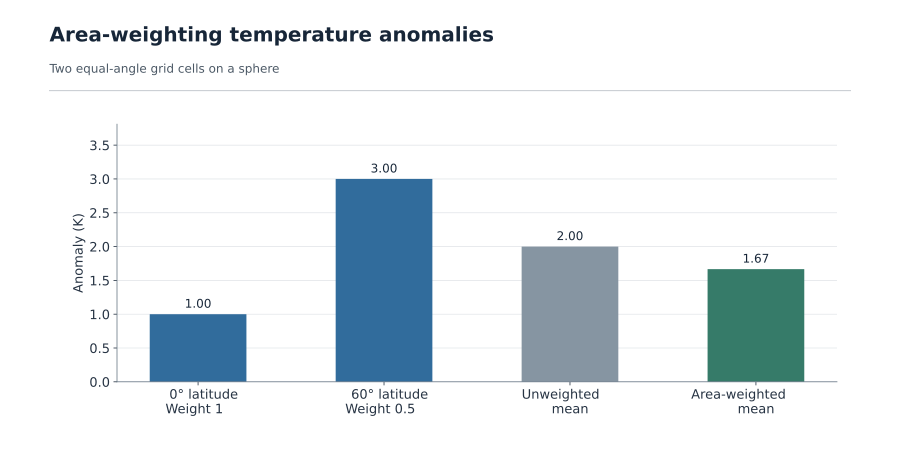

# M30-L4 – Climate, Environment, Geospatial Data and Sustainability {#L4}

**Course area:** M30 – Data Science in Science and Society

**Level:** Master · Compulsory elective/applications

**Prerequisites:** M20, M21, M27, M28.

**Learning objective:** Aggregate gridded data with area weighting and avoid spatial and temporal validation errors.

## Climate data as spatiotemporal measurement fields {#S1}

A climate dataset describes, for example, temperature, precipitation or wind on a space–time grid. Weather stations, satellites and reanalyses are distinct data products. A reanalysis such as ERA5 combines observational information with a physical model, so its grid values are not directly measured temperatures everywhere. Before combining data, check coordinate systems, grid resolution, measurement height, calendars, temporal aggregation and units. Unlike instantaneous temperature, accumulated precipitation must not be averaged without accounting for the accumulation interval. Temperature differences measured in kelvin are numerically equal to differences measured in degrees Celsius.

## Area weighting and anomalies {#S2}




*Figure: Area-weighted temperature anomalies.*

Equally sized angular cells on a regular latitude–longitude grid cover different areas on a sphere. For equally wide, symmetrical latitude bands with equal longitude steps, the weighting is proportional to $\cos\varphi_i$. More generally, cell area is proportional to $\Delta\lambda(\sin\varphi_{\mathrm{N}}-\sin\varphi_{\mathrm{S}})$. Consider two equal-angle sample cells at latitudes 0° and 60° with anomalies of 1 and 3 K. Their weights are 1 and 0.5. Thus,
$$\bar a=\frac{1\cdot1+0.5\cdot3}{1+0.5}=1{,}\overline{6}\,\mathrm{K}.$$
The unweighted mean of 2 K overestimates the area-weighted anomaly here. An anomaly is the departure from a defined reference (for example, the same calendar month during a reference period), not necessarily an absolute temperature. Where cells are masked, compute the denominator over valid areas and report coverage.

```python
import numpy as np
lat=np.array([0,60]); a=np.array([1.,3.]); w=np.cos(np.deg2rad(lat))
weighted=np.average(a,weights=w)
assert np.isclose(weighted,5/3)
print(a.mean(),weighted)
```

## Spatial validation and sustainability {#S3}

Adjacent cells and consecutive days are often dependent. Randomly splitting individual grid cells can make models appear successful even when they merely interpolate nearby observations. Spatial block evaluation, temporal holdouts and tests on extreme events provide different, often stricter evidence. A flood model additionally requires hydrological processes, catchment areas and independent events; a climate correlation does not establish a local cause. For sustainability applications, specify system boundaries, the comparison period and uncertainty in emission factors. An area-weighted temperature must not be confused with population-weighted exposure.

## Exercise with solution {#S4}

**Task:** A third equal-angle cell at latitude −60° has an anomaly of 2 K. Determine the new weighted anomaly.

**Solution:** $(1+1.5+0.5\cdot2)/(1+0.5+0.5)=1.75\,\mathrm{K}$.

## Sources and further reading {#S5}

- [Copernicus Climate Change Service: Climate reanalysis](https://climate.copernicus.eu/climate-reanalysis) · ERA5 section opened
