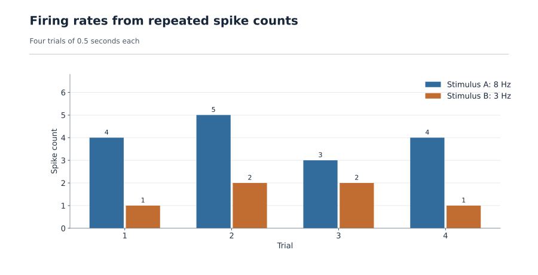

# M30-L5 – Computational Neuroscience and Behavioural Data {#L5}

**Course area:** M30 – Data Science in Science and Society

**Level:** Master · Compulsory elective/applications

**Prerequisites:** M20, M21, M27, M28.

**Learning objective:** Convert spike data into firing rates and assess what statistical neural coding can establish.

## Neural and behavioural signals {#S1}

Computational neuroscience studies mathematical models of nervous systems and relates them to measurement data. Electrophysiology, for example, provides event times for individual neurons or groups of neurons; EEG measures electrical potential differences at the scalp, while fMRI captures indirect haemodynamic signals. These methods have different temporal and spatial resolutions. A study might examine whether neural activity depends on a stimulus or a decision. Trial, session, participant and neural unit represent different sampling levels. Stimulus timing, movement and measurement artefacts affect interpretation.

## Spike counts and firing rate {#S2}




*Figure: Neuronal firing rates from spike counts.*

A spike train is represented by a sequence of event times $t_k$. Across $R$ repetitions of an identical time window of length $\Delta t$, the mean rate can be estimated by $\hat r=\sum_{j=1}^R N_j/(R\Delta t)$. Four synthetic trials, each lasting 0.5 s, yield spike counts of 4, 5, 3, 4 for stimulus A and 1, 2, 2, 1 for stimulus B. The rates are 8 Hz and 3 Hz. Under independent homogeneous Poisson processes, $N_j\sim\mathrm{Poisson}(r\Delta t)$. The model-based standard error of the rate is approximately $\sqrt{\hat r/(R\Delta t)}$, or 2 Hz for A in this example. The model ignores refractory periods, variable excitability and dependence between trials. A time-varying rate can be estimated over shorter windows or through smoothing, trading temporal resolution against higher estimation uncertainty.

```python
import numpy as np
counts=np.array([[4,5,3,4],[1,2,2,1]])
r=counts.sum(axis=1)/2
se=np.sqrt(r/2)
assert np.allclose(r,[8,3]) and np.isclose(se[0],2)
print(r,se)
```

## Encoding, decoding and behaviour {#S3}

An encoding model maps stimuli and context to neural responses; a decoding model attempts the reverse, predicting a stimulus or behaviour from activity. Good decodability is not proof that the brain uses that particular algorithm. Time windows from the same trial must stay within the same data partition, and testing generalisation to new participants requires participant-grouped splits. A Poisson GLM with a logarithmic link function can model rates as functions of stimuli and past activity. Its performance can be assessed using held-out data and log-likelihood, among other criteria. Consent and access controls are essential for personal data.

## Exercise with solution {#S4}

**Task:** Across eight trials of 0.25 s each, a total of 12 spikes is observed. What are the firing rate and Poisson standard error?

**Solution:** Exposure is 2 s and rate is 6 Hz; the standard error is $\sqrt{6/2}=\sqrt3\approx1.73\,\mathrm{Hz}$.

## Sources and further reading {#S5}

- [Gerstner et al. (2014): Neuronal Dynamics, 7.2 Mean Firing Rate](https://neuronaldynamics.epfl.ch/online/Ch7.S2.html) · textbook section opened
