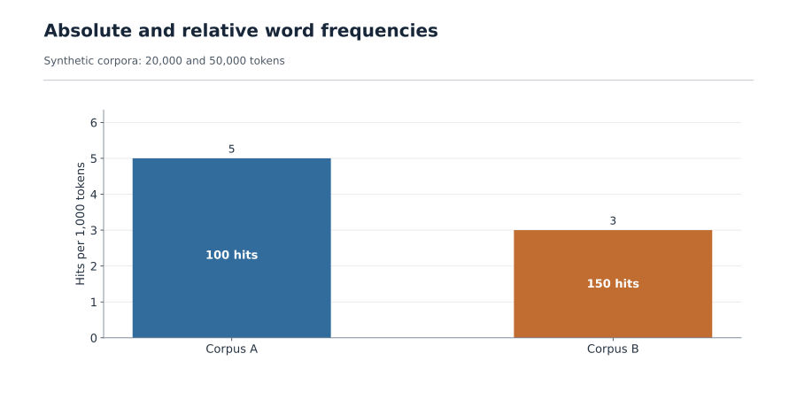

# M30-L6 – Digital Humanities and Text Corpora {#L6}

**Course area:** M30 – Data Science in Science and Society

**Level:** Master · Compulsory elective/applications

**Prerequisites:** M20, M21, M27, M28.

**Learning objective:** Prepare historical corpora critically and interpret normalised word frequencies and OCR errors.

## From source to corpus {#S1}

Digital humanities use computational methods to study questions in the humanities and cultural research. A digitised newspaper archive is not a representative sample of a society in the past. What survives, selection for digitisation, place of publication and genre all shape a corpus. Optical character recognition (OCR) converts scans into machine-readable text; handwritten material may require handwriting text recognition (HTR). Each document should have a stable source ID, date, provenance, page reference, transcription status and, where possible, a link to the original. Preserve the unmodified raw transcription; corrections and tokenisation form versioned processing steps. Historical spellings should not be silently modernised.

## Normalised frequencies and measurement errors {#S2}




*Figure: Absolute versus relative word frequencies.*

Two fictional subcorpora contain 20,000 and 50,000 words respectively. The word ‘Garten’ occurs 100 and 150 times. Absolute counts rise by 50%, but the relative frequencies per thousand tokens are $1000\cdot100/20000=5$ and $1000\cdot150/50000=3$. Claims about language use therefore depend on the denominator and corpus composition. In a manually checked reference sample of 2,000 characters with 40 substitutions, 10 deletions and 6 insertions, the character error rate is $CER=(40+10+6)/2000=2.8\%$. The errors are derived from a minimum edit alignment. Words in rare scripts or damaged pages may be disproportionately affected. CER alone is not a measure of the reliability of any particular word count.

```python
import numpy as np
freq=1000*np.array([100,150])/np.array([20000,50000])
cer=(40+10+6)/2000
assert np.allclose(freq,[5,3]) and np.isclose(cer,.028)
print(freq,cer)
```

## Distant reading, close reading and source criticism {#S3}

Collocations, topic models, embeddings and named-entity recognition help researchers select potentially interesting passages. Interpretations must be traced back to specific passages. A change in meaning over time may accompany a constant frequency; shifts in genre may create trends without any change in society. Useful safeguards include stratified subcorpora, manual samples for each period and sensitivity analyses for tokenisation or OCR corrections. The frequency of a term is not automatically the frequency of the event it describes. Copyright, archive conditions and sensitive personal information must be checked before sharing.

## Exercise with solution {#S4}

**Task:** A third corpus contains 90 hits in 30,000 tokens. What is its frequency, and which earlier corpus does it match?

**Solution:** $1000\cdot90/30000=3$ per thousand tokens, matching the second corpus without establishing identical meanings.

## Sources and further reading {#S5}

- [Crump (2014): Generating an Ordered Data Set from an OCR Text File](https://programminghistorian.org/en/lessons/generating-an-ordered-data-set-from-an-OCR-text-file) · introduction and learning objectives opened
