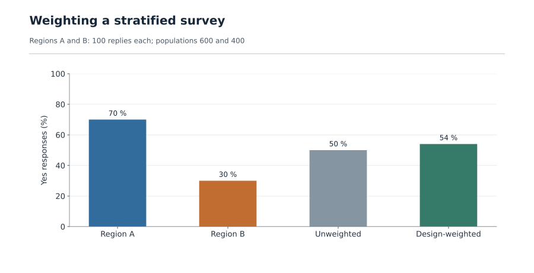

# M30-L7 – Social Research, Survey Data and Weighting {#L7}

**Course area:** M30 – Data Science in Science and Society

**Level:** Master · Compulsory elective/applications

**Prerequisites:** M20, M21, M27, M28.

**Learning objective:** Apply design weights and calibration and distinguish sampling error from systematic non-response.

## Target population and selection mechanism {#S1}

Social surveys aim to describe attitudes, living conditions or behaviours in a defined population. A sampling frame may exclude people; self-selection, non-response and ambiguous questions can also cause bias. A dataset with many responses is not necessarily representative. In a probability sample, unit $i$ has a known positive inclusion probability $\pi_i$. Its design weight $d_i=1/\pi_i$ corrects unequal selection probabilities. The Horvitz–Thompson estimator $\widehat Y=\sum_{i\in s}d_i y_i$ is design-unbiased for the population total if all units can be reached and their values observed. For a mean with known population size $N$, $\widehat Y/N$ may be used. A ratio with an estimated denominator, however, is generally not exactly unbiased.

## Weighted estimation in two strata {#S2}




*Figure: Survey strata and design weights.*

A synthetic population has 600 people in region A and 400 in region B. From each region, 100 people are selected by simple random sampling without replacement, and all respond. In A, 70 answer yes to a question, compared with 30 in B. The inclusion probabilities are $1/6$ and $1/4$ and the weights are 6 and 4. The unweighted proportion is 0.5, but the weighted estimate is
$$\frac{6\cdot70+4\cdot30}{6\cdot100+4\cdot100}=0.54.$$
The difference results from disproportionate stratification. For stratum proportions $\hat p_h$, a design-based variance can be approximated by $\sum_h (N_h/N)^2(1-n_h/N_h)s_h^2/n_h$, where $s_h^2=n_h\hat p_h(1-\hat p_h)/(n_h-1)$ is the sample variance of a binary response. Cluster samples require a different variance calculation.

```python
import numpy as np
N=np.array([600,400]); n=np.array([100,100]); yes=np.array([70,30])
w=N/n; p=yes/n
estimate=(w@yes)/N.sum()
s2=n*p*(1-p)/(n-1)
se=np.sqrt(np.sum((N/N.sum())**2*(1-n/N)*s2/n))
assert np.isclose(estimate,.54) and .02<se<.04
print(estimate,se)
```

## Non-response, calibration and limitations {#S3}

Non-response may be adjusted through inverse estimated response probabilities if the assumed model is adequate and response probabilities are positive. Calibration alters weights so that weighted totals for known auxiliary characteristics agree with population totals. Very large weights often increase variance; simple trimming changes the estimate in turn. One diagnostic is $n_{\mathrm{eff}}=(\sum w_i)^2/\sum w_i^2$, which reflects weight inequality alone rather than every design effect. Weighting does not necessarily resolve an unknown association between the target variable and non-response. Question wording, social desirability, data protection and reporting rules remain important.

## Exercise with solution {#S4}

**Task:** How does the weighted proportion change if B provides only 20 instead of 30 yes answers while everything else remains constant?

**Solution:** $(420+80)/1000=0.50$. The weights remain unchanged because selection and the total number of respondents are unchanged.

## Sources and further reading {#S5}

- [Hasler (2024): Inference from sampling with response probabilities estimated via calibration](https://www150.statcan.gc.ca/n1/pub/12-001-x/2024002/article/00013-eng.htm) · abstract opened
