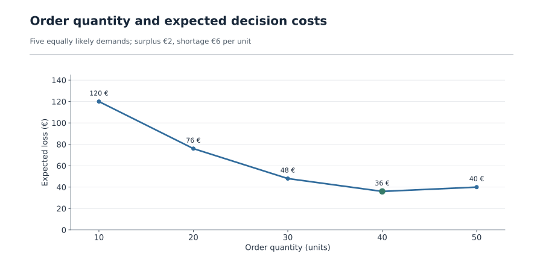

# M30-L8 – Economics, Forecasts, Information Management and IT Controlling {#L8}

**Course area:** M30 – Data Science in Science and Society

**Level:** Master · Compulsory elective/applications

**Prerequisites:** M20, M21, M27, M28.

**Learning objective:** Align forecasts with decision costs and incorporate information management and IT controlling into evaluation.

## Economic decisions using data {#S1}

A retailer wants to derive order quantities from demand forecasts. Time series from sales systems do not always represent demand: when stock runs out, sales are capped by availability. Prices, promotions and public holidays may be useful features if they are known at forecast time. Data provenance must be documented using item, branch and time identifiers. Information management defines responsibilities, data quality, indicators and interfaces; BI dashboards alone do not resolve inconsistent definitions. A forecast is economically useful only if it leads to an executable decision.

## Asymmetric costs and quantile forecasts {#S2}




*Figure: Inventory quantities and expected costs.*

In a simplified single-period inventory model, each surplus unit costs €2, while each missing unit costs €6. For order quantity $q$ and demand $d$, the loss is $L(q,d)=2\max(q-d,0)+6\max(d-q,0)$. Without further constraints, a $\tau=6/(6+2)=0.75$ quantile of the demand distribution minimises expected loss. In the continuous case, the derivative of expected loss is $2F(q)-6(1-F(q))$, which vanishes at $F(q)=0.75$. For discrete data, the quantile jump must be considered. Five equally probable synthetic demand scenarios are 10, 20, 30, 40 and 50. Ordering 30 incurs an average cost of €48, ordering 40 incurs €36, and ordering 50 incurs €40. Of the five candidate quantities, 40 is optimal, not the median of 30.

```python
import numpy as np
d=np.array([10,20,30,40,50]); q=d[:,None]
loss=(2*np.maximum(q-d,0)+6*np.maximum(d-q,0)).mean(axis=1)
assert np.allclose(loss,[120,76,48,36,40]) and d[loss.argmin()]==40
print(loss)
```

## Controlling, backtests and data operations {#S3}

Forecast quality should be evaluated on later data not used in training, including against a simple seasonal reference model. MAE and RMSE characterise statistical errors, whereas the loss function above evaluates the business decision. IT controlling adds comparable cost accounting for development, deployment, data collection, monitoring and maintenance. An expected annual benefit of €20,000 against additional operating costs of €12,000 gives a net effect of €8,000 before further risks and taxes. The metric must be documented with clear system boundaries, realistic assumptions and scenarios. A historical backtest cannot guarantee future profits; real deployment may itself change prices and demand.

## Exercise with solution {#S4}

**Task:** How does the target quantile change if surplus stock costs €4 while shortage still costs €6?

**Solution:** $\tau=6/(4+6)=0.6$. The higher surplus penalty lowers the target quantile; the available order quantities should be re-evaluated.

## Sources and further reading {#S5}

- [Hyndman and Athanasopoulos: Forecasting: Principles and Practice, 3rd ed., Chapter 5](https://otexts.robjhyndman.com/fpp3/toolbox.html) · section on forecast accuracy opened
