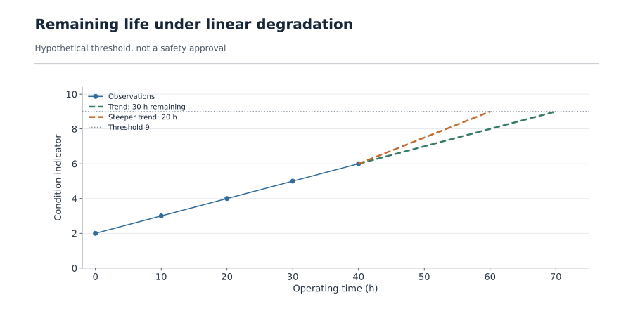

# M30-L9 – Industry, Manufacturing and Predictive Maintenance {#L9}

**Course area:** M30 – Data Science in Science and Society

**Level:** Master · Compulsory elective/applications

**Prerequisites:** M20, M21, M27, M28.

**Learning objective:** Distinguish remaining useful life, early warnings and condition-based maintenance, and recognise temporal evaluation boundaries.

## From sensor data to maintenance {#S1}

Industrial plants monitor temperature, vibration, power consumption and throughput. Condition monitoring describes the current state, anomaly detection flags unusual patterns, and predictive maintenance estimates, for example, the remaining useful life (RUL). High vibration can also result from a change in load; an anomaly does not uniquely diagnose a fault. Equipment identifiers, operating regimes, maintenance logs and timestamps are required. Image-based inspection and process data may be combined for a manufactured part, but a change in product type can shift the data distribution.

## A simple degradation model {#S2}




*Figure: Degradation trends and remaining useful life.*

A fictional condition indicator $z$ is measured at five operating times of 0, 10, 20, 30 and 40 hours, with respective values of 2, 3, 4, 5 and 6. A linear trend $\hat z(t)=2+0.1t$ has a slope of 0.1 units per hour. If a hypothetical threshold of $z=9$ is used, extrapolation reaches it at $t=70$ hours. With 40 hours already elapsed, the model-based remaining life is 30 hours. Another plausible increase of 0.15 units per hour from the current level of 6 would instead yield a remaining life of only 20 hours. The threshold must be determined and validated technically; it cannot be inferred from a model score alone. Linear extrapolation ignores accelerated degradation, changes in operating regime and sudden failures.

```python
import numpy as np
t=np.arange(0,41,10); z=np.arange(2.,7.)
b,a=np.polyfit(t,z,1); crossing=(9-a)/b
rul=crossing-t[-1]
assert np.isclose(b,.1) and np.isclose(rul,30)
print(a,b,rul,(9-z[-1])/.15)
```

## Maintenance decisions and independent evaluation {#S3}

Condition-based decisions account for failure costs, spare-part availability, lead times, occupational safety and measurement uncertainty. In a simplified decision example, preventive maintenance costs €200 and an unplanned failure has an expected cost of €1,000. If maintenance completely prevents failure within the relevant window and has no other consequences, it is preferable in expectation when the failure probability exceeds 0.2. Realistic models include imperfect effectiveness and further costs. Evaluation separates entire machines rather than random time windows, uses only features available at decision time, and documents warning lead time and false-alarm rate. Machines that have not failed may provide right-censored observations. The NASA C-MAPSS dataset is a simulation benchmark, not evidence of safe decisions for a real plant.

## Exercise with solution {#S4}

**Task:** Given a current indicator of 7 and an estimated increase of 0.05 units per hour, what remaining time does the threshold of 9 imply?

**Solution:** $(9-7)/0.05=40$ hours under purely linear extrapolation. This is not a guaranteed safe maintenance date.

## Sources and further reading {#S5}

- [NASA: Prognostics Center of Excellence Data Set Repository](https://www.nasa.gov/intelligent-systems-division/discovery-and-systems-health/pcoe/pcoe-data-set-repository/) · Section 6, Turbofan Engine Degradation Simulation, opened
