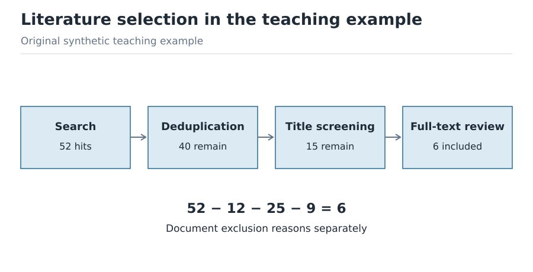

# M31-L1 – Literature Review, Research Questions and Hypotheses {#L1}

**Course area:** M31 – Research Seminar and Master's Project

**Level:** Master · Practice/research

**Prerequisites:** M17, M18, M19, M27, M28.

**Learning objective:** Formulate a testable research question, select literature transparently and distinguish hypotheses from exploratory conjectures.

## From observation to a research gap {#S1}

A research seminar does not begin by selecting the most complex possible model. It begins with a problem whose existing solutions and limitations need to be understood. The running synthetic teaching example is forecasting the next day's electricity consumption at small monitoring stations. The fictional stations provide temperature and consumption data; the course does not claim that a real field experiment has taken place. One question is: Does temperature-based regression reduce the mean absolute forecast error compared with a simple baseline, including at previously unseen stations? This specifies the outcome, comparator and target of generalisation. The question is predictive, not causal: an accurate forecast does not establish that an intervention changes consumption.

## A reproducible literature search {#S2}




*Figure: Literature selection in a synthetic review.*

First specify the databases, search period, search strings and selection rules. One possible search expression is `("energy demand" OR "electricity consumption") AND (forecasting OR prediction) AND ("external validation" OR "cross-site")`. Adapt it to each database's syntax where necessary and record the date, filters and number of hits. After deduplication, screen titles and abstracts, followed by full texts. Distinguish methodological contributions, external evaluations and reviews. For each included study, record its data type, forecast horizon, baseline, split, metrics, uncertainty and limitations. Where metrics are inconsistent, a structured qualitative synthesis may be more appropriate than a pooled numerical average. PRISMA provides a reporting framework for systematic reviews; a search list or simplified flow diagram does not automatically satisfy its requirements.

```python
hits, duplicates, excluded_title, excluded_full = 52, 12, 25, 9
included = hits - duplicates - excluded_title - excluded_full
assert included == 6
print(included)
```

These figures are invented. They demonstrate only a consistent selection flow; no actual literature search was conducted for this example.

## Measurable hypotheses and decisions {#S3}

For each test station, define the difference $d_i=\operatorname{MAE}_{\mathrm{ref},i}-\operatorname{MAE}_{\mathrm{neu},i}$ in kWh. Positive values favour the new model. A directional hypothesis formulated in advance is $H_0:\mu_d\leq 0$ versus $H_1:\mu_d>0$. For a two-sided test, the alternative would be $\mu_d\ne 0$; the direction must not be changed after inspecting the data. A practically relevant improvement of, for example, 1 kWh should be specified in addition to the statistical question. A protocol also sets out stopping rules, exclusion criteria, planned sensitivity analyses and how unexpected observations will be assessed. Findings from exploratory analysis may motivate new hypotheses, but these require independent confirmation.

## Exercise with solution {#S4}

**Task:** Of 63 search hits, 13 are duplicates; another 30 titles and 15 full texts are excluded. How many studies remain?

**Solution:** 63 − 13 − 30 − 15 = 5 studies remain. Reasons for exclusion must also be documented.

## Sources and further reading {#S5}

- [DFG: Guideline 9 – Research design](https://www.wissenschaftliche-integritaet.de/en/gl-09-395054) · guideline and explanation opened
- [PRISMA 2020: Statement and overview](https://www.prisma-statement.org/prisma-2020) · overview opened
