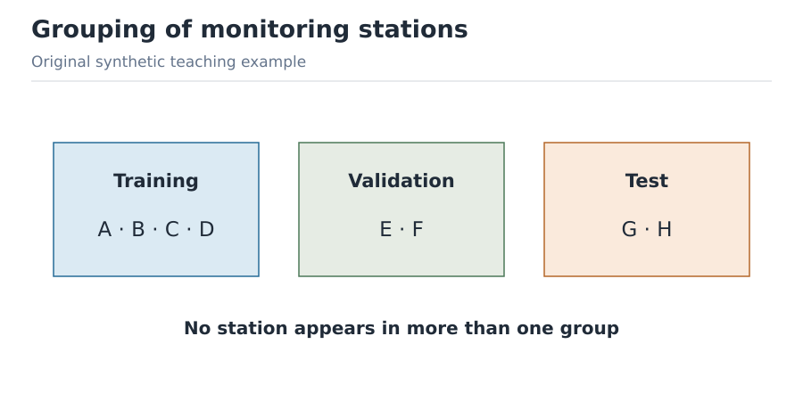

# M31-L2 – Research Design, Comparative Methods and Datasets {#L2}

**Course area:** M31 – Research Seminar and Master's Project

**Level:** Master · Practice/research

**Prerequisites:** M17, M18, M19, M27, M28, [M31-L1](M31-L1.md).

**Learning objective:** Design fair model comparisons using independent groups, predefined metrics and controlled model selection.

## What is the unit of generalisation? {#S1}

A dataset may contain thousands of daily observations despite covering only a few stations. If days from the same station are randomly assigned to training and test sets, the model may exploit station-specific information. For the question of performance at unseen stations ([M31-L1](M31-L1.md)), stations must be separated as groups. Forecasts must also use only information available when the prediction is made: for instance, tomorrow's temperature as measured afterwards is not a legitimate feature, whereas a weather forecast available at the time is. Geographic and temporal generalisation may require separate tests. The design must reflect the intended deployment situation.

## Baselines, budgets and analysis plan {#S2}




*Figure: Station-level split without overlap.*

A simple baseline could be a fixed mean estimated exclusively from training data. Other fair baselines include the latest available observation and a seasonal reference, provided each is available at forecast time. Document search spaces and selection budgets for both the proposed method and more complex baselines. Choose hyperparameters and preprocessing using training and validation data only; use a sealed test set once for the primary evaluation. Optimising multiple models against the final test set undermines its independence. An external test dataset from a different monitoring network may provide further evidence, but does not replace a description of measurement conditions and selection mechanisms.

```python
train = {'A', 'B', 'C', 'D'}
valid = {'E', 'F'}
test = {'G', 'H'}
assert not (train & valid or train & test or valid & test)
assert len(train | valid | test) == 8
print(len(train), len(valid), len(test))
```

These eight stations are merely a minimal illustration, not an adequate sample size for reliable inference.

## Measurement protocol and target metric {#S3}

For station $i$ with $n_i$ observed days, $\operatorname{MAE}_i=\frac{1}{n_i}\sum_{t=1}^{n_i}|y_{it}-\hat y_{it}|$. If all stations are weighted equally, the primary metric is $\frac{1}{m}\sum_i\operatorname{MAE}_i$. Weighting by days addresses a different question: stations with more observations have greater influence. Also measure error during high loads, with missing features and during sensor outages. Record data provenance, measurement interval, units, time zone, availability, rights, quality checks and the rules for missing target values. Model selection, sample-size planning and reporting are connected: arbitrarily many data rows cannot replace a precise statement about the target population.

## Exercise with solution {#S4}

**Task:** Station A has an MAE of 2 kWh over 2 days; station B has an MAE of 4 kWh over 6 days. Calculate the equally station-weighted and day-weighted MAE.

**Solution:** Equal station weights: (2 + 4)/2 = 3 kWh; equal day weights: (2·2 + 6·4)/8 = 3.5 kWh.

## Sources and further reading {#S5}

- [DFG: Guideline 9 – Research design](https://www.wissenschaftliche-integritaet.de/en/gl-09-395054) · guideline and explanation opened
- [NeurIPS: Paper Checklist](https://neurips.cc/public/guides/PaperChecklist) · sections on reproducibility, experiment design and uncertainty selectively reviewed
