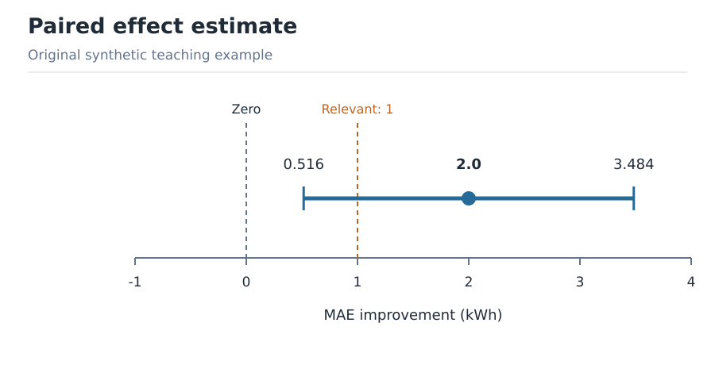

# M31-L3 – Sample-Size Planning, Uncertainty and Statistical Analysis {#L3}

**Course area:** M31 – Research Seminar and Master's Project

**Level:** Master · Practice/research

**Prerequisites:** M17, M18, M19, M27, M28, [M31-L2](M31-L2.md).

**Learning objective:** Plan the number of independent study units and report paired effects with uncertainty.

## Planning around the smallest relevant effect {#S1}

When comparing two forecasts at the same stations, the station-level difference in error is the variable of interest. Suppose a pilot study suggests a standard deviation of differences of $\sigma_d=2$ kWh. A difference of $\Delta=1$ kWh is predefined as relevant. Assuming independent, approximately normally distributed differences and using a normal approximation, a two-sided test with significance level $\alpha=0.05$ and target power $1-\beta=0.8$ gives approximately:

$$n\approx\left(\frac{(z_{1-\alpha/2}+z_{1-\beta})\sigma_d}{\Delta}\right)^2.$$

With quantiles 1.96 and 0.842, this gives approximately 31.4, hence at least 32 stations under this approximation. Exact planning using a t distribution, uncertainty in the pilot estimates, an allowance for attrition and dependencies may require a larger sample. The outcome and test here are specified as two-sided; the directional hypothesis in [M31-L1](M31-L1.md) would require a different analysis plan.

## Paired analysis of a teaching dataset {#S2}




*Figure: Paired estimate of a mean improvement.*

Six fictional independent test stations yield MAE differences $d=(2,1,3,2,0,4)$ kWh. The mean is $\bar d=2$ kWh and the sample standard deviation is $s_d=\sqrt{2}$ kWh. Assuming independent, normally distributed differences, the two-sided 95% t confidence interval is

$$\bar d\pm t_{0.975,n-1}\frac{s_d}{\sqrt n}.$$

With five degrees of freedom and the quantile 2.571, the interval is approximately [0.516, 3.484] kWh. Zero lies outside this interval, but the practically relevant value 1 lies inside. The interval therefore does not establish that the improvement exceeds 1 kWh. The six stations are not outcomes of the experiment planned in S1; they constitute a small numerical example.

```python
import numpy as np
from scipy.stats import t, norm
d = np.array([2., 1., 3., 2., 0., 4.])
n = len(d)
mean = d.mean(); sd = d.std(ddof=1)
h = t.ppf(.975, n-1)*sd/np.sqrt(n)
plan = int(np.ceil(((norm.ppf(.975)+norm.ppf(.8))*2)**2))
assert np.isclose(sd, np.sqrt(2)) and plan == 32
assert np.allclose([mean-h, mean+h], [.5158739, 3.4841261], atol=.002)
print(plan, mean, mean-h, mean+h)
```

## Dependence, multiple tests and interpretation {#S3}

Daily observations from one station must not be treated as independent station-level replications. If entire regions are jointly affected by weather events, even a station-level test may be too optimistic. Possible remedies include an appropriate hierarchical model or resampling at the level of independent clusters, with assumptions checked in either case. Multiple endpoints and model variants require a multiple-comparison plan (M6); exploratory findings must remain clearly identified. An interval containing zero does not prove equivalence, and a small p-value alone says nothing about effect size or practical value. Report the effect estimate, uncertainty, sampling unit and deviations from the protocol.

## Exercise with solution {#S4}

**Task:** How does the normal-approximation sample size from S1 change if the smallest relevant difference increases to 2 kWh?

**Solution:** The ratio is halved, so its square becomes one quarter; approximately 7.85, rounded up to 8 stations under this approximation.

## Sources and further reading {#S5}

- [NIST: Confidence intervals for differences between means, §7.3.1.2](https://itl.nist.gov/div898/handbook/prc/section3/prc312.htm) · formula for paired differences reviewed
- [NeurIPS: Paper Checklist](https://neurips.cc/public/guides/PaperChecklist) · sections on reproducibility, experiment design and uncertainty selectively reviewed
