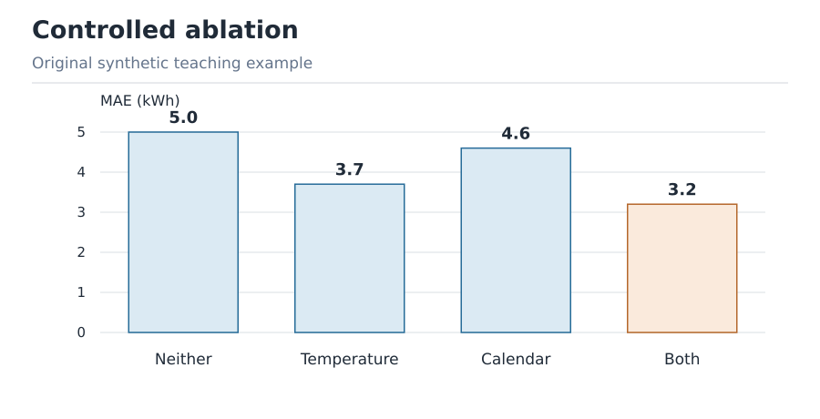

# M31-L4 – Reproducibility, Ablation and Debugging {#L4}

**Course area:** M31 – Research Seminar and Master's Project

**Level:** Master · Practice/research

**Prerequisites:** M17, M18, M19, M27, M28, [M31-L3](M31-L3.md).

**Learning objective:** Analyse a controlled ablation study and distinguish technical reproducibility from causal claims.

## A result must be verifiable {#S1}

A single successful training run provides little evidence that a result can be reproduced. Record the dataset version, code revision, configuration, preprocessing, library versions, hardware and random sources. A deterministic seed alone does not guarantee identical results for all parallel or hardware-dependent operations. Before running the experiment, specify whether bit-for-bit reproducibility is required or whether a scientifically justified numerical tolerance is sufficient. Document negative findings and failed attempts as well; research data subject to access restrictions must not simply be published. A synthetic substitute dataset can demonstrate that software runs, but not validate the originally reported empirical results.

## Ablation as a targeted model comparison {#S2}




*Figure: Controlled feature-group ablation.*

Suppose a model combines temperature and calendar features. In an illustrative ablation, four variants are trained under the same splitting, selection and evaluation rules, and assessed at the same stations. The following aggregate MAE values are invented for demonstration, not observed results.

| Features | MAE in kWh |
|---|---:|
| No additional features | 5.0 |
| Temperature only | 3.7 |
| Calendar only | 4.6 |
| Temperature and calendar | 3.2 |

The improvement due to temperature is 1.3 kWh without calendar features and 1.4 kWh with them. The additional joint benefit relative to the additive model can be expressed as the difference between these improvements: 0.1 kWh. Without an uncertainty analysis, this is not robust evidence of an interaction. Moreover, the comparison would not be properly controlled if model capacities or budgets differed substantially.

```python
v = {(0,0):5., (1,0):3.7, (0,1):4.6, (1,1):3.2}
a = v[0,0]-v[1,0]; b = v[0,1]-v[1,1]
assert abs((b-a)-.1) < 1e-9
print(a,b,b-a)
```

## Debugging with counterchecks {#S3}

Begin with a small dataset for which the expected output can be calculated by hand. Check data ordering, the mapping of target values, units and forecast horizon. A model that still performs unusually well on an independent test after its training targets have been randomly permuted may indicate leakage or an evaluation error; this observation alone does not establish the cause. Compare training and validation behaviour, log modifications and reproduce a bug with an automated test before applying a patch. A bug report includes expected and observed behaviour, minimal input, environment and a control experiment. Confirm a correction by rerunning the relevant test, while avoiding optimisation against the actual test set.

## Exercise with solution {#S4}

**Task:** Suppose the full model has an MAE of 3.4 rather than 3.2 kWh. What is the additional joint benefit relative to additivity?

**Solution:** Temperature with calendar: 4.6 − 3.4 = 1.2. Without calendar: 1.3; the difference is −0.1 kWh.

## Sources and further reading {#S5}

- [NeurIPS: Paper Checklist](https://neurips.cc/public/guides/PaperChecklist) · sections on reproducibility, experiment design and uncertainty selectively reviewed
- [DFG: Guideline 12 – Documentation](https://www.wissenschaftliche-integritaet.de/en/gl-12-395172) · guideline and explanation opened
