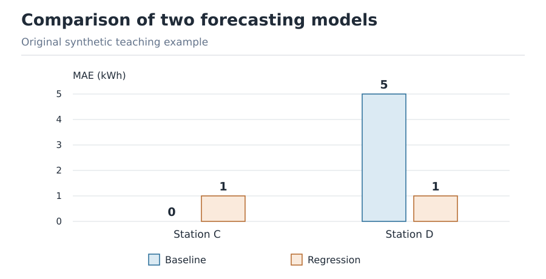

# M31-L5 – Project Work with a Documented Data and Model Pipeline {#L5}

**Course area:** M31 – Research Seminar and Master's Project

**Level:** Master · Practice/research

**Prerequisites:** M17, M18, M19, M27, M28, [M31-L4](M31-L4.md).

**Learning objective:** Create a small, independently executable research artefact with a fixed split, baseline model and reproducible results.

## From protocol to research artefact {#S1}

The following project is a minimal synthetic example based on [M31-L1](M31-L1.md) to [M31-L4](M31-L4.md). It compares linear regression with a constant baseline. Input $x$ is a fictional temperature, in degrees Celsius, known at forecast time; target $y$ is daily consumption in kWh. In a real project, the measurement protocol, data licence, temperature forecasts and deployment conditions would need separate examination. Define a project structure with immutable raw data, a version-controlled processing script, results in a separate folder and a README containing installation and execution instructions. The analysis must not rely on hidden manual steps. The embedded data are sufficient to reproduce the entire teaching run.

## Executable minimal experiment {#S2}




*Figure: Two forecasting methods across test stations.*

Two training stations, A and B, each supply three days; two independent test stations, C and D, each supply two days. The models are fixed in advance, so no hyperparameters are selected and no validation group is used in this minimal example. Actual model development would require one, as described in [M31-L2](M31-L2.md). Both the fitted model and the baseline mean use training values exclusively.

```python
import numpy as np
x_train = np.array([0.,1.,2.,3.,4.,5.])
y_train = np.array([10.,12.,14.,16.,18.,20.])
x_test = np.array([2.,3.,4.,5.])
y_test = np.array([15.,15.,19.,21.])
group_train = np.array(['A','A','A','B','B','B'])
group_test = np.array(['C','C','D','D'])
assert not set(group_train)&set(group_test)
X = np.column_stack([np.ones(len(x_train)),x_train])
beta = np.linalg.lstsq(X,y_train,rcond=None)[0]
pred = beta[0]+beta[1]*x_test
baseline = np.full(len(x_test), y_train.mean())
def station_mae(pred):
    return np.array([np.mean(np.abs(y_test[group_test==g]-pred[group_test==g]))
                     for g in np.unique(group_test)])
m_ref, m_new = station_mae(baseline), station_mae(pred)
assert np.allclose(beta,[10,2])
assert np.allclose(m_ref,[0,5]) and np.allclose(m_new,[1,1])
print(beta, m_ref, m_new, (m_ref-m_new).mean())
```

The model is $\hat y=10+2x$, and the baseline is 15 kWh. The equally station-weighted MAEs are 2.5 and 1 kWh, respectively; the mean paired improvement is 1.5 kWh. At station C, the new method performs worse (−1 kWh improvement); at D, it performs better (+4 kWh). Reporting only the overall mean conceals this heterogeneity.

## Quality assurance and handover {#S3}

Use a development phase and a frozen evaluation phase. In a real project, the dataset version, configuration, result files and their provenance must be uniquely traceable. The README specifies the Python and NumPy versions, or a reproducible environment, the execution command and expected outputs. A reviewer should be able to trace inputs and outputs without further questions; store any new run separately from the original results. The two test stations in this teaching example are insufficient for a reliable statement about the target population. The linear relationship in the training data is also deliberately constructed. A project report must describe these limitations and must not present this teaching result as field validation.

## Exercise with solution {#S4}

**Task:** The new model has MAEs of 1 and 2 kWh at C and D. The baseline is unchanged. What is the mean equally station-weighted improvement?

**Solution:** The differences are −1 and +3 kWh; their mean is 1 kWh.

## Sources and further reading {#S5}

- [NeurIPS: Paper Checklist](https://neurips.cc/public/guides/PaperChecklist) · sections on reproducibility, experiment design and uncertainty selectively reviewed
- [DFG: Guideline 12 – Documentation](https://www.wissenschaftliche-integritaet.de/en/gl-12-395172) · guideline and explanation opened
