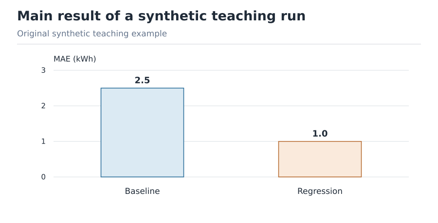

# M31-L6 – Research Reports, Peer Review and Scientific Presentations {#L6}

**Course area:** M31 – Research Seminar and Master's Project

**Level:** Master · Practice/research

**Prerequisites:** M17, M18, M19, M27, M28, [M31-L5](M31-L5.md).

**Learning objective:** Turn results, evidence and limitations into a verifiable research report and a comprehensible presentation.

## An argument rather than a collection of results {#S1}

A research report first explains the problem and the gap in existing research. The research question, study design, data basis and methods then follow. Separate results from their interpretation: the observed difference is a result; its possible origin or transferability belongs in the discussion. Tables and figures must make the units, unit of analysis, sample size, direction of improvement and, where applicable, the representation of uncertainty clear. Relevant counterfindings belong alongside favourable results. The miniature experiment from [M31-L5](M31-L5.md) demonstrates traceability, but cannot support reliable claims about a population of real stations.

## An example of verifiable reporting {#S2}




*Figure: Main result of a synthetic project.*

For the teaching run, the equally station-weighted MAEs of the baseline and regression are 2.5 and 1 kWh. The absolute difference is 1.5 kWh, or 60% relative to the baseline. This relative measure refers to this particular error aggregate, not to a reduction in electricity consumption; if the baseline error were zero, relative improvement would be undefined. The station-specific differences are −1 and +4 kWh. A responsible statement is: In this minimal synthetic experiment, the regression had a lower mean error, although its error was larger at one of the two test stations. No claim about real monitoring networks is established by this result.

```python
ref,new = 2.5,1.
abs_gain = ref-new; rel_gain = abs_gain/ref
assert abs_gain == 1.5 and rel_gain == .6
print(abs_gain,rel_gain)
```

For an empirical result with an adequate sample, predefined uncertainty analyses and sensitivity checks would be added. The two stations in this teaching run must not be combined with the six stations in the separate interval calculation in [M31-L3](M31-L3.md).

## Peer review and presentation {#S3}

Peer review examines whether claims, data, methods and conclusions fit together. Review comments identify specific passages, justify criticisms and distinguish essential errors from optional extensions. Possible responses are to correct an error and recompute the result, provide a reasoned rebuttal or disclose a limitation that cannot be resolved. In a response log, connect every comment to a change, evidence and location. Confidential material received for review must not be shared without permission, and conflicts of interest must be disclosed. A brief presentation may cover the question, design, one main figure, the most important limitation and the next research question. Computational artefacts, sources and detailed methods should remain available for the subsequent discussion. A persuasive figure is not a substitute for methodological scrutiny.

## Exercise with solution {#S4}

**Task:** For a baseline error of 4 kWh and a model error of 3.5 kWh, what are the absolute and relative improvements?

**Solution:** 0.5 kWh and 0.5/4 = 12.5%, respectively. The percentage describes the error, not energy savings.

## Sources and further reading {#S5}

- [NeurIPS: Paper Checklist](https://neurips.cc/public/guides/PaperChecklist) · sections on reproducibility, experiment design and uncertainty selectively reviewed
- [DFG: Code of Conduct – Overview](https://www.wissenschaftliche-integritaet.de/en/code) · overview of the guidelines opened
