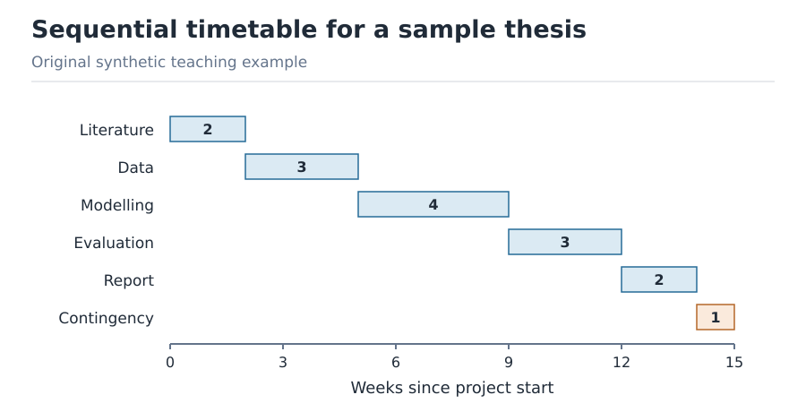

# M31-L7 – Master's Thesis Planning, Limitations and Open Research Questions {#L7}

**Course area:** M31 – Research Seminar and Master's Project

**Level:** Master · Practice/research

**Prerequisites:** M17, M18, M19, M27, M28, [M31-L6](M31-L6.md).

**Learning objective:** Plan a realistic Master's thesis and translate the scope of the results into concrete follow-up studies.

## Defining a bounded project {#S1}

A Master's thesis does not have to solve every open problem in AI. It needs a precise question, a suitable method, realistic data access and a documented evaluation plan. The teaching example could become a proposal examining whether temperature-based forecasts are more robust than several simple baselines at new stations. Before formal registration, clarify with the supervisor which examination regulations apply, which data may be used, the actual registration, preparation and submission deadlines, and available supervision. The plan proposed here is an original teaching example, not a binding university rule. State a minimum research question that can be completed even if findings are negative, with optional extensions.

## Dependencies, contingency and decision points {#S2}




*Figure: Example thesis work schedule.*

A fictional plan allocates two weeks to literature and protocol, three to data access and preparation, four to modelling, three to evaluation, two to reporting and one as contingency. Literature work may partially overlap with timely clarification of data access; protected data must not be processed without the necessary legal authorisation. In the simple sequential scenario, the total is 15 weeks. Set decision points: Are data available and of sufficient quality? Can the baseline run? Is the analysis plan frozen? Are results reproducible? Have report and artefact checks passed? If access is still unresolved after three weeks, the scope may be adjusted in consultation with the supervisor or a permitted alternative dataset investigated. Any change in the target population must be documented.

```python
weeks = [2,3,4,3,2,1]
assert sum(weeks)==15
remaining_without_buffer = sum(weeks[:-1])
assert remaining_without_buffer==14
print(sum(weeks),remaining_without_buffer)
```

## Limitations as starting points for new research {#S3}

Internal validity concerns the reliability of the comparison under the conditions studied; external validity concerns transferability to other stations, regions or periods. Construct validity asks whether, for example, MAE adequately captures the operational objective of interest. Sample size, measurement error, outages, selection bias and model choice all affect these aspects. Pair each important limitation with a possible test: few stations → a predefined independent sample; homogeneous region → external validation in other regions; uncertain weather forecast → comparison across forecast qualities; limited error metric → additional evaluation under high loads. Neither a high test score nor successful implementation resolves such questions. Depending on the project, a complete thesis includes a transparent protocol, a methodological account, results and error analysis, documented artefacts and a justified discussion including negative findings. Only then does the next research cycle begin.

## Exercise with solution {#S4}

**Task:** Data preparation takes two weeks longer, while the rest of the sequential plan stays unchanged. How long does the work take if the contingency is used up completely?

**Solution:** 14 weeks of core work + 2 weeks of delay = 16 weeks, one week beyond the originally planned total of 15 weeks.

## Sources and further reading {#S5}

- [DFG: Guideline 9 – Research design](https://www.wissenschaftliche-integritaet.de/en/gl-09-395054) · guideline and explanation opened
- [DFG: Guideline 12 – Documentation](https://www.wissenschaftliche-integritaet.de/en/gl-12-395172) · guideline and explanation opened
- [DFG: Code of Conduct – Overview](https://www.wissenschaftliche-integritaet.de/en/code) · overview of the guidelines opened
