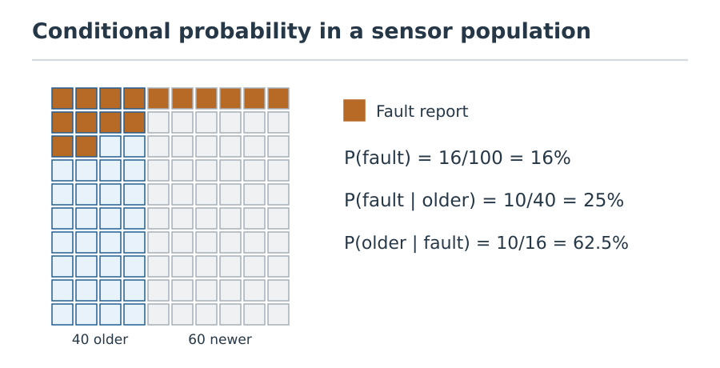

# M4-L1 – Events and conditional probability {#L1}

**Course area:** M4 – Probability and stochastic models

**Level:** Bachelor · Core/Fundamentals

**Prerequisites:** M2.

**Learning objective:** Model events, calculate conditional probabilities and distinguish independence from mutual exclusivity.

## From experiment to model {#S1}

A random experiment does not necessarily describe a physically random process. An unknown state of a device can also be modelled as uncertainty. The sample space $\Omega$ contains all outcomes envisaged in the model. An event $A$ is a set of outcomes. The events form a sigma-algebra: it contains $\Omega$ and is closed under complements and countable unions. A probability measure satisfies $P(\Omega)=1$, non-negativity and countable additivity for pairwise disjoint events. It follows that $P(A^c)=1-P(A)$ and

$$P(A\cup B)=P(A)+P(B)-P(A\cap B).$$

In a finite sample space with equally likely outcomes, counting suffices. With unequal probabilities, one cannot simply divide by the number of outcomes.

## Conditioning changes the reference set {#S2}

*Figure: Conditional probability in a sensor population.*

In a synthetic population of 100 sensors, 40 belong to an older series $B$. Of these, 10 report a fault $A$. Of the remaining 60, 6 report a fault. When a device is selected uniformly, $P(A)=16/100=0.16$, $P(B)=0.4$ and $P(A\cap B)=0.1$. For $P(B)>0$,

$$P(A\mid B)=\frac{P(A\cap B)}{P(B)}=\frac{10}{40}=0.25.$$

The denominator now covers only the older series. In the reverse direction, $P(B\mid A)=10/16=0.625$. The two statements answer different questions. The product rule $P(A\cap B)=P(B)P(A\mid B)$ makes this direction explicit. For a disjoint, exhaustive partition $B_i$ with positive probabilities, $P(A)=\sum_i P(A\mid B_i)P(B_i)$.

## Independence and limitations {#S3}

Independence means $P(A\cap B)=P(A)P(B)$. In our example, the product would be $0.064$, not $0.1$. Age and fault reporting are therefore dependent in the model. This does not yet establish that age causes the fault. Disjoint events with positive probabilities are never independent: their intersection has probability zero. Likewise, a probability of zero in continuous models does not necessarily mean logical impossibility.

## Exercise and solution {#S4}

A randomly selected device belongs to the newer series. What is the probability of a fault? Also calculate $P(A\cup B)$.

Solution: $6/60=0.1$. The union includes all 40 older devices and the 6 faulty newer devices, giving $46/100=0.46$. Check using the union formula: $0.16+0.4-0.1=0.46$.

## Sources and further reading {#S5}

- [Penn State, STAT 414: Introduction to Probability Theory (course overview)](https://online.stat.psu.edu/statprogram/stat414) – **Verification:** pending.
- [MIT OpenCourseWare 18.05, Readings (overview)](https://ocw.mit.edu/courses/18-05-introduction-to-probability-and-statistics-spring-2022/resources/readings/) – **Verification:** pending.
