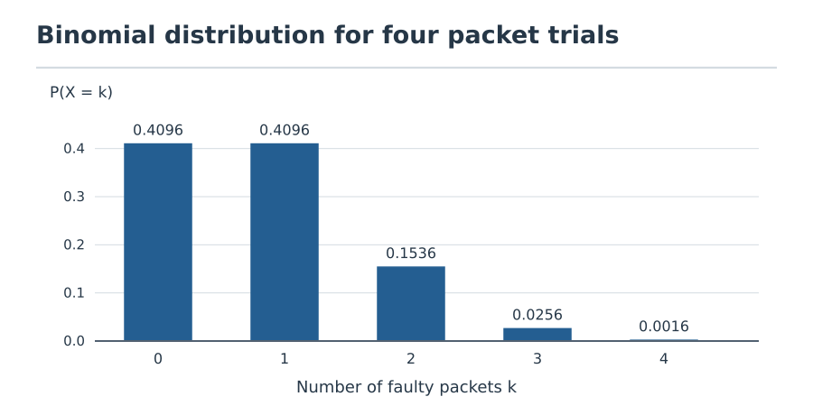

# M4-L2 – Random variables and discrete distributions {#L2}

**Course area:** M4 – Probability and stochastic models

**Level:** Bachelor · Core/Fundamentals

**Prerequisites:** M2; [M4-L1](M4-L1.md).

**Learning objective:** Distinguish and apply discrete random variables, probability mass functions and typical count distributions.

## From outcome to number {#S1}

A random variable $X$ is a measurable mapping from the sample space to the real numbers. In three transmission attempts, the outcome may be a sequence of successes and failures, while $X$ records only the number of failures. Different sequences can produce the same value. For a discrete random variable, $p_X(k)=P(X=k)$, $p_X(k)\geq 0$ and $\sum_k p_X(k)=1$. The cumulative distribution function $F_X(x)=P(X\leq x)$ sums the masses up to and including $x$; it is right-continuous and is typically a step function in discrete models.

## Bernoulli and binomial distributions {#S2}

*Figure: Binomial distribution for four packet trials.*

In a trial with two possible outcomes, $X=1$ encodes the event of interest and $X=0$ its absence. The Bernoulli distribution has parameter $p=P(X=1)$. Summing $n$ independent, identically distributed Bernoulli trials produces a binomial variable. For $k=0,\dots,n$,

$$P(X=k)=\binom nk p^k(1-p)^{n-k}.$$

The binomial coefficient counts the possible arrangements of $k$ events. For four independent packets with failure probability $p=0.2$, the masses for $k=0,1,2,3,4$ are exactly 0.4096, 0.4096, 0.1536, 0.0256 and 0.0016. At least one failure occurs with probability $1-0.4096=0.5904$. The mass for exactly one failure, by contrast, is 0.4096.

## Other discrete models {#S3}

The Poisson distribution $P(X=k)=e^{-\lambda}\lambda^k/k!$ with $k\geq0$ and $\lambda>0$ models, for example, counts in a fixed time window at constant intensity and with independent increments of a Poisson process. It approximates a binomial distribution for large $n$, small $p$ and $np\approx\lambda$. The geometric distribution $P(T=k)=(1-p)^{k-1}p$ for $k=1,2,\dots$ describes the number of independent trials until the first event ($0<p\leq1$). The successful trial is included. Sampling without replacement from a finite population generally requires another model, such as the hypergeometric distribution. Dependent packet failures following a network outage also violate the binomial assumptions.

## Exercise and solution {#S4}

For four packets, calculate the probability of at most one failure and of at least two failures. Which assumption would need to be reconsidered if there were a common source of disruption?

Solution: $P(X\leq1)=0.8192$, $P(X\geq2)=0.1808$. Common disruptions may violate independence; an unchanged $p$ alone is not sufficient.

## Sources and further reading {#S5}

- [Penn State, STAT 414: Introduction to Probability Theory (course overview)](https://online.stat.psu.edu/statprogram/stat414) – **Verification:** pending.
- [MIT OpenCourseWare 18.05, Readings (overview)](https://ocw.mit.edu/courses/18-05-introduction-to-probability-and-statistics-spring-2022/resources/readings/) – **Verification:** pending.
