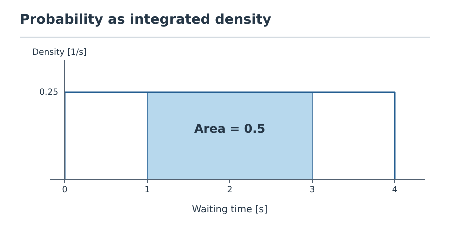

# M4-L3 – Continuous distributions and densities {#L3}

**Course area:** M4 – Probability and stochastic models

**Level:** Bachelor · Core/Fundamentals

**Prerequisites:** M2; [M4-L2](M4-L2.md).

**Learning objective:** Interpret continuous models, integrate interval probabilities and explain the parameters of common densities.

## Probabilities as areas {#S1}

For an absolutely continuous random variable $X$ with density $f$, the probability of an interval is

$$P(a\leq X\leq b)=\int_a^b f(x)\,dx.$$

The density is non-negative and its integral over the real line is one. A single point has probability zero. The density itself is not a probability: it can exceed one and, for a quantity measured in seconds, has units of $1/\mathrm{s}$. The area is dimensionless. From $F(x)=\int_{-\infty}^x f(t)\,dt$, if $F$ is differentiable, we recover $f(x)=F'(x)$. This reversal is not possible for every arbitrary distribution; mixtures of point masses and densities also exist.

## Uniform distribution and interval calculations {#S2}

*Figure: Probability as integrated density.*

Suppose the waiting time of an idealised inspection cycle is uniformly distributed between 0 and 4 seconds. Then $f(x)=1/4\,\mathrm{s}^{-1}$ on this interval and is zero elsewhere. For 1 to 3 seconds, the area is $2\cdot1/4=0.5$. On the interval, $F(x)=x/4$ when time is expressed numerically in seconds; before it the value is zero, and after it one. If the same time is expressed in milliseconds, the density becomes 0.00025 per millisecond. The probability remains the same.

## Normal and exponential distributions {#S3}

The normal distribution $\mathcal N(\mu,\sigma^2)$ with $\sigma>0$ has density

$$f(x)=\frac{1}{\sigma\sqrt{2\pi}}\exp\left(-\frac{(x-\mu)^2}{2\sigma^2}\right).$$

It models, for example, symmetric measurement deviations without hard bounds; it is standardised by $Z=(X-\mu)/\sigma$. A different model is often appropriate for positive waiting times. For $x\geq0$, the exponential distribution has density $\lambda e^{-\lambda x}$ and survival function $P(X>x)=e^{-\lambda x}$, with rate $\lambda>0$. It has a constant hazard rate and mean waiting time $1/\lambda$. Not every waiting time satisfies this assumption; ageing or time limits may contradict it.

## Exercise and solution {#S4}

A measurement is uniformly distributed between 2 and 2.4 volts. Calculate the density and the probability of 2.1 to 2.2 volts. Explain why the density may exceed one.

Solution: $1/0.4=2.5\,\mathrm V^{-1}$; the interval width is 0.1 V, so $P=0.25$. The density value is probability mass per unit, not the probability of an individual point.

## Sources and further reading {#S5}

- [MIT OpenCourseWare 18.05, Readings (overview)](https://ocw.mit.edu/courses/18-05-introduction-to-probability-and-statistics-spring-2022/resources/readings/) – **Verification:** pending.
- [Penn State, STAT 414, Lesson 14: Continuous Random Variables](https://online.stat.psu.edu/stat414/Lesson14) – **Verification:** pending.
