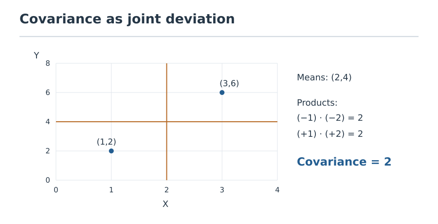

# M4-L4 – Expectation, variance and covariance {#L4}

**Course area:** M4 – Probability and stochastic models

**Level:** Bachelor · Core/Fundamentals

**Prerequisites:** M2; [M4-L3](M4-L3.md).

**Learning objective:** Calculate expectation, variance and covariance and understand their significance for combined decisions.

## An expected value is not always a possible outcome {#S1}

For a discrete random variable with finite absolute expectation, $E[X]=\sum_x xP(X=x)$; in the absolutely continuous case, $E[X]=\int xf_X(x)\,dx$. Depending on its load, a system takes 2 or 8 seconds with probabilities 0.75 and 0.25. The mean time is $\mu=2\cdot0.75+8\cdot0.25=3.5$ seconds. No individual run need take exactly 3.5 seconds. In repeated independent, identically distributed runs, the sample mean approaches this expectation under suitable conditions.

## Variance and scaling {#S2}

For a finite second moment,

$$\operatorname{Var}(X)=E[(X-\mu)^2]=E[X^2]-\mu^2.$$

In the load example, $E[X^2]=0.75\cdot4+0.25\cdot64=19$, hence $\operatorname{Var}(X)=6.75\,\mathrm{s}^2$ and $\sigma\approx2.598\,\mathrm s$. The standard deviation has the same unit as the measured quantity. For constants $a,b$, $E[aX+b]=aE[X]+b$ and $\operatorname{Var}(aX+b)=a^2\operatorname{Var}(X)$. For heavy-tailed models, the existence of moments must be checked; the Cauchy distribution, for example, has no defined ordinary expectation.

## Two quantities and covariance {#S3}

*Figure: Covariance as joint deviation.*

The covariance $\operatorname{Cov}(X,Y)=E[(X-E[X])(Y-E[Y])]$ captures joint linear deviations. In a model with equally likely pairs $(X,Y)=(1,2),(3,6)$, the means are 2 and 4, the variances 1 and 4, and the covariance 2. The Pearson correlation $\rho=\operatorname{Cov}(X,Y)/(\sigma_X\sigma_Y)$ is 1 here. It is defined only when both standard deviations are positive. With finite second moments, independence implies zero covariance, but not conversely. For $X$ uniformly distributed over $-1,0,1$, $Y=X^2$ depends on $X$, yet $E[XY]=0=E[X]E[Y]$.

## Exercise and solution {#S4}

For the two quantities in the paired example, calculate $E[X+Y]$ and $\operatorname{Var}(X+Y)$.

Solution: expectations add without an independence assumption: 6. The variance is $1+4+2\cdot2=9$. The two possible sums, 3 and 9, are each three units from the mean. Omitting the covariance underestimates the spread in this model.

## Sources and further reading {#S5}

- [Penn State, STAT 414: Introduction to Probability Theory (course overview)](https://online.stat.psu.edu/statprogram/stat414) – **Verification:** pending.
- [MIT OpenCourseWare 18.05, Readings (overview)](https://ocw.mit.edu/courses/18-05-introduction-to-probability-and-statistics-spring-2022/resources/readings/) – **Verification:** pending.
