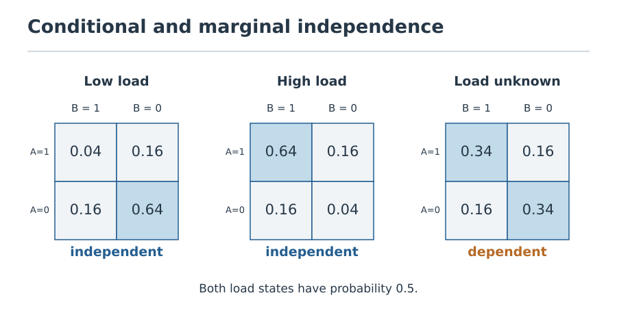

# M4-L5 – Joint distributions and conditional independence {#L5}

**Course area:** M4 – Probability and stochastic models

**Level:** Bachelor · Core/Fundamentals

**Prerequisites:** M2; [M4-L4](M4-L4.md).

**Learning objective:** Distinguish joint, marginal and conditional distributions and check conditional independence in a model.

## Joint probabilities {#S1}

A joint discrete distribution contains $p(x,y)=P(X=x,Y=y)$ and sums to one over all pairs. The marginal distribution is obtained by summing over the other variable: $p_X(x)=\sum_y p(x,y)$. For $p_X(x)>0$, $p(y\mid x)=p(x,y)/p_X(x)$. With a joint density, integration over the other variable replaces summation; the conditional density is defined as a quotient for suitable $x$ with positive marginal density. The factorisation $p(x,y)=p_X(x)p_Y(y)$ for all pairs characterises discrete independence.

## A common influence {#S2}

*Figure: Conditional and marginal independence.*

Two alarms $A,B$ each trigger with probability 0.8 in state $Z=1$ (high load) and with probability 0.2 in state $Z=0$. Both states are equally likely. Assume the alarms are independent within each state. Then

$$P(A,B\mid Z=z)=P(A\mid Z=z)P(B\mid Z=z).$$

Here $A$ and $B$ each denote a triggered alarm. Without knowledge of the state, $P(A)=P(B)=0.5$, whereas $P(A\cap B)=0.5\cdot0.64+0.5\cdot0.04=0.34$. The product of the marginal probabilities is 0.25. The alarms are therefore marginally dependent, even though they are independent within each state group.

## Benefits and limitations of factorisation {#S3}

The joint distribution of all three variables can be written as $p(z)p(a\mid z)p(b\mid z)$ in this case. Thus, for the two binary alarms, only the individual probabilities for each state need to be known, rather than parametrising all alarm combinations independently. Such assumptions are a core component of probabilistic models. They must, however, be justified in the application domain: two alarms connected to the same faulty controller may be dependent even if the load state is known. Additional conditioning can also create dependencies; when selection is influenced by both variables, initially independent quantities can become dependent within the selected group.

## Exercise and solution {#S4}

Determine the joint table of alarm outcomes without knowing $Z$ and the probability that B triggers given that A has triggered.

Solution: $P(1,1)=0.34$, $P(1,0)=0.16$, $P(0,1)=0.16$, $P(0,0)=0.34$. The sum is one. Conditional on A, the probability is $0.34/0.5=0.68$. Without knowledge of A, it was 0.5.

## Sources and further reading {#S5}

- [Penn State, STAT 414: Introduction to Probability Theory (course overview)](https://online.stat.psu.edu/statprogram/stat414) – **Verification:** pending.
- [Penn State, STAT 414, Lesson 20: Distributions of Two Continuous Random Variables](https://online.stat.psu.edu/stat414/Lesson20) – **Verification:** pending.
