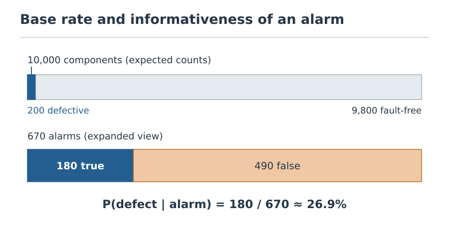

# M4-L6 – Bayes' theorem and probabilistic prediction {#L6}

**Course area:** M4 – Probability and stochastic models

**Level:** Bachelor · Core/Fundamentals

**Prerequisites:** M2; [M4-L5](M4-L5.md).

**Learning objective:** Distinguish the prior, likelihood, posterior and predictive probabilities, and calculate with base rates.

## Information updates a model {#S1}

For two events $H$ and $D$ with $P(D)>0$ and $P(H)>0$, the product rule gives

$$P(H\mid D)=\frac{P(D\mid H)P(H)}{P(D)}.$$

$P(H)$ is called the prior probability; $P(D\mid H)$, viewed as a function of the hypothesis, is called the likelihood. The denominator is the evidence; it normalises the posterior probabilities. The likelihood is not automatically a distribution over hypotheses. For an exhaustive disjoint set of discrete hypotheses, $P(D)=\sum_h P(D\mid h)P(h)$.

## Inspection signal and base rate {#S2}

*Figure: Base rate and informativeness of an alarm.*

A synthetic quality inspector raises an alarm for 90% of genuinely defective components. An alarm is also raised for 5% of fault-free components. The defect rate is 2%. Among 10,000 representative components, the model probabilities correspond to expected counts of 200 defective and 9,800 fault-free components. We expect 180 true alarms and 490 false alarms. Given an alarm, therefore,

$$P(H\mid D)=\frac{0.02\cdot0.9}{0.02\cdot0.9+0.98\cdot0.05}=\frac{180}{670}\approx0.269.$$

A high detection rate is thus not equivalent to a high probability of an actual defect after the signal. The result depends on the base rate and the false alarm rate.

## From hypothesis to prediction {#S3}

A posterior distribution over an unknown model parameter can be used for a new observation. In the discrete case, $P(Y_{\mathrm{neu}}=y\mid D)=\sum_h P(Y_{\mathrm{neu}}=y\mid h,D)P(h\mid D)$. If the new observation is independent of the previous data given $h$, the first factor simplifies to $P(Y_{\mathrm{neu}}=y\mid h)$. A second independent inspection of the same component would again have alarm rates of 0.9 and 0.05 conditional on the known defect status. After the first alarm, the predicted probability of a second alarm is therefore $0.9\cdot180/670+0.05\cdot490/670\approx0.2784$. Repetitions of the same measurement error would not constitute independent evidence.

## Exercise and solution {#S4}

Repeat the calculation from S2 with a defect base rate of 10%. What has changed?

Solution: $0.09/(0.09+0.045)=2/3\approx0.667$. The inspection rates remain the same, but the higher prior changes the posterior. A classification decision additionally requires the costs or benefits of the possible decisions.

## Sources and further reading {#S5}

- [Penn State, STAT 414: Introduction to Probability Theory (course overview)](https://online.stat.psu.edu/statprogram/stat414) – **Verification:** pending.
- [MIT OpenCourseWare 18.05, Readings (overview)](https://ocw.mit.edu/courses/18-05-introduction-to-probability-and-statistics-spring-2022/resources/readings/) – **Verification:** pending.
