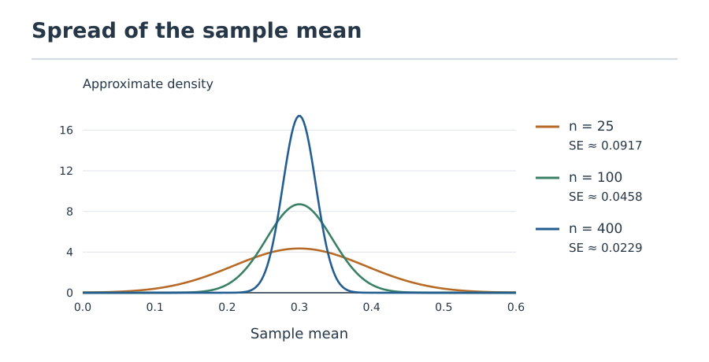

# M4-L7 – Law of large numbers and central limit theorem {#L7}

**Course area:** M4 – Probability and stochastic models

**Level:** Bachelor · Core/Fundamentals

**Prerequisites:** M2; [M4-L6](M4-L6.md).

**Learning objective:** Distinguish the consistency of the sample mean from asymptotic normality and calculate typical estimation variability.

## Mean as the sample grows {#S1}

Let $X_1,\ldots,X_n$ be independent and identically distributed with mean $\mu$ and finite variance $\sigma^2$. The sample mean $\bar X_n=n^{-1}\sum_i X_i$ satisfies $E[\bar X_n]=\mu$ and $\operatorname{Var}(\bar X_n)=\sigma^2/n$. Chebyshev's inequality gives, for every $\varepsilon>0$,

$$P(|\bar X_n-\mu|\geq\varepsilon)\leq\frac{\sigma^2}{n\varepsilon^2}\longrightarrow0.$$

Under these assumptions, this proves the weak law of large numbers: convergence in probability. It does not say that every new observation reduces the error. Under suitable assumptions, the strong law gives almost sure convergence; these two concepts must be distinguished.

## Central limit theorem {#S2}

*Figure: Spread of the sample mean.*

Under the preceding assumptions with $0<\sigma^2<\infty$,

$$\frac{\sqrt n(\bar X_n-\mu)}{\sigma}\xrightarrow{d}\mathcal N(0,1).$$

The standardised deviation converges in distribution, not to a single fixed value. The theorem explains why many sample means are approximately normally distributed even though individual values are not normally distributed. For Bernoulli variables with $p=0.3$, $\sigma^2=0.21$. For $n=25,100,400$, the standard errors are approximately 0.0917, 0.0458 and 0.0229. The distribution of individual observations remains unchanged; only the means become increasingly concentrated.

## What the central limit theorem does not guarantee {#S3}

There is no magic sample size valid for all distributions at which the normal approximation becomes accurate. Very rare events, strongly skewed distributions and heavy tails can impair the approximation. For observations correlated over time, the variance formula generally does not hold: covariances between observations must be included. More data from a biased selection process may cause the sample mean to converge precisely to the wrong target. Increasing the sample size therefore replaces neither sound data collection nor model validation.

## Exercise and solution {#S4}

Suppose an independent measurement process has $\sigma=6$ ms. How many measurements are needed for a standard error of at most 0.5 ms? What is the Chebyshev bound for a deviation of at least 2 ms at this sample size?

Solution: $6/\sqrt n\leq0.5$ requires $n\geq144$. The bound is $36/(144\cdot4)=0.0625$. It is an upper bound, not the exact error probability.

## Sources and further reading {#S5}

- [MIT OpenCourseWare 18.05, Readings (overview)](https://ocw.mit.edu/courses/18-05-introduction-to-probability-and-statistics-spring-2022/resources/readings/) – **Verification:** pending.
- [Penn State, STAT 414, Section 5: Distributions of Functions of Random Variables](https://online.stat.psu.edu/stat414/Section05) – **Verification:** pending.
