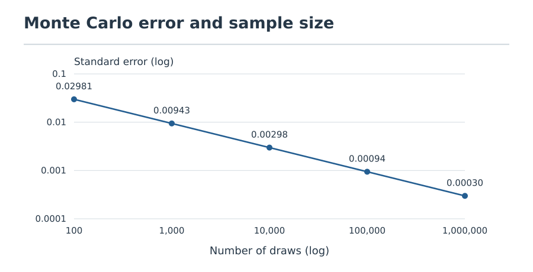

# M4-L8 – Simulation and Monte Carlo fundamentals {#L8}

**Course area:** M4 – Probability and stochastic models

**Level:** Bachelor · Core/Fundamentals

**Prerequisites:** M2; [M4-L7](M4-L7.md).

**Learning objective:** Construct Monte Carlo estimators, quantify simulation error and implement essential conditions for reproducibility.

## Simulation as expectation calculation {#S1}

Monte Carlo methods approximate quantities using randomly generated samples. For independent draws $X_i$ from a specified model and a function $g$, $\hat\theta_n=n^{-1}\sum_i g(X_i)$ is an estimator of $\theta=E[g(X)]$. With a finite second moment, its variance is $\operatorname{Var}(g(X))/n$. An event probability is obtained with $g(X)=\mathbf1_A(X)$; the mean of the zeros and ones is the observed hit rate. The standard deviation of the estimator can be estimated by $s_g/\sqrt n$. Model inaccuracy must be assessed separately from this numerical sampling error.

## Evaluating an integral numerically {#S2}




*Figure: Monte Carlo error and sample size.*

Suppose we want to evaluate the integral $I=\int_0^1 x^2\,dx=1/3$. Since the uniform distribution on $[0,1]$ has density one, $I=E[U^2]$. The analytical variance of $U^2$ is $1/5-1/9=4/45$. For 10,000 independent draws, the theoretical standard error is about 0.002981.

```python
import numpy as np
rng = np.random.default_rng(731)
u = rng.random(10_000)
g = u**2
estimate = g.mean()
se = g.std(ddof=1) / np.sqrt(g.size)
print(f"I = {estimate:.6f}, SE = {se:.6f}")
```

The seed allows reproduction in the same suitable environment and with the same sequence of generator calls. NumPy does not guarantee identical bit streams across versions for `Generator`. The result may differ slightly from 1/3; a result close to the target alone does not prove that the implementation is correct. Given sufficiently many independent draws, an approximate 95% interval for the modelled expectation is $\hat\theta_n\pm1.96\widehat{SE}$. It describes the repeated-sampling coverage of the procedure, not the quality of the underlying model.

## Efficiency and risks {#S3}

The typical error size decreases only as $1/\sqrt n$. A tenfold reduction in standard deviation requires a hundred times as many draws. For extremely rare events, a naive simulation can produce mostly zeros and misleadingly yield an empirical spread of zero. Alternatives such as importance sampling alter the sampling distribution and correct for this by weighting; they require additional mathematical conditions. The naive standard error is likewise not applicable to dependent simulations such as Markov chains. Document the random source, sample size, model assumptions and diagnostics.

## Exercise and solution {#S4}

How many draws does the integral example require for a theoretical standard error of at most 0.001?

Solution: $\sqrt{4/(45n)}\leq0.001$ gives $n\geq88{,}888.89$. Rounding up, 88,889 draws are required. This statement does not apply to a guaranteed maximum absolute error.

## Sources and further reading {#S5}

- [MIT OpenCourseWare 18.05, Readings (overview)](https://ocw.mit.edu/courses/18-05-introduction-to-probability-and-statistics-spring-2022/resources/readings/) – **Verification:** pending.
- [NumPy, Random Generator, API reference](https://numpy.org/doc/stable/reference/random/generator.html) – **Verification:** pending.
