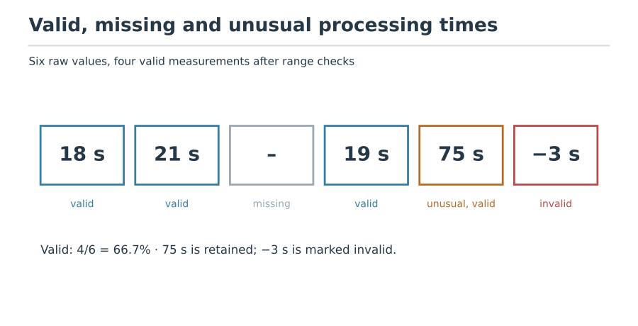

# M5-L1 – Data cleaning, missing values and outliers {#L1}

**Course area:** M5 – Exploratory data analysis and visualisation

**Level:** Bachelor · Core/Fundamentals

**Prerequisites:** [M1-L6](M1-L6.md); [M3-L4](M3-L4.md), [M3-L6](M3-L6.md); [M4-L1](M4-L1.md).

**Learning objective:** Distinguish errors, missing observations and plausible extreme values, and plan traceable cleaning steps.

## From raw data to analysis data {#S1}

*Figure: Valid, missing and unusual processing times.*

A measurement log contains six processing times in seconds: 18, 21, missing, 19, 75 and −3. The last value is impossible for a duration; 75 s, on the other hand, is unusual but possible. Cleaning begins with a data contract: expected types, units, permissible ranges, keys and the meaning of missing entries. Raw data remain unchanged; a derived table contains the corrected values and flags for each change. A duplicate key must first be investigated: it may indicate a transmission error or two genuinely distinct measurements.

An empty entry is not zero. If −3 is marked invalid, four observed values remain. The observed completeness of the column is $4/6=66.7\,\%$. The graphic preview shows this status before any possible imputation.

## Why values are missing {#S2}

Let $R=1$ when a measurement is present, and otherwise $R=0$. Data may be missing completely at random (MCAR: missingness depends on neither observed nor unobserved values). Under MAR, the probability of missingness may depend on observed quantities but no longer on the missing value itself once those quantities are taken into account. MNAR refers to situations in which this condition does not hold, for example when particularly long processing times are not recorded. These mechanisms cannot usually be determined unambiguously from the available data alone.

Removing incomplete rows can affect groups to different degrees. Simple median imputation produces a complete column, but often reduces observed variability and does not reflect uncertainty about the imputed values. For model training, imputation rules must be estimated exclusively from the training data. In exploratory analysis, it is often more useful to report valid observations and missingness rates together.

## Diagnosing outliers {#S3}

An unusual value is neither automatically erroneous nor automatically an interesting discovery. Check sensor limits, timestamps, units and repeated measurements. For a plausible extreme value, robust measures ([M5-L2](M5-L2.md)) and sensitivity analysis are useful: the mean of the four valid processing times is $(18+21+19+75)/4=33.25$ s; without 75 s it would be $58/3\approx19.33$ s. The large change shows influence but does not justify deletion. The treatment rule must be substantively justified and documented.

## Exercise and solution {#S4}

A log contains 100 rows. Eight durations are originally missing and two others are negative. What is the valid proportion if these cases are distinct? How should the analysis proceed?

Solution: 90 out of 100 durations are valid. Report the reasons for the ten missing or invalid values separately, examine their distribution by device and time period, and initially analyse the 90 valid values without arbitrary imputation. A missing time value does not mean that no event took place.

## Sources and further reading {#S5}

- [Wickham, Çetinkaya-Rundel and Grolemund: R for Data Science (2e), Chapter 10: Exploratory data analysis](https://r4ds.hadley.nz/EDA) – **Verification:** pending.
- [pandas: Working with missing data (User Guide)](https://pandas.pydata.org/docs/user_guide/missing_data.html) – **Verification:** pending.
